# Project_template

Это шаблон для решения проектной работы. Структура этого файла повторяет структуру заданий. Заполняйте его по мере работы над решением.

[Исходные условия проекта](docs/project-brief.md): текущее решение, целевая экосистема, лэндскейп компании и цели бизнеса.

# Задание 1. Анализ и планирование

### 1. Описание функциональности монолитного приложения

Описание текущей системы (As-Is) основано на [условиях проекта](docs/project-brief.md). Возможности учебной реализации отмечены отдельно.

**Управление отоплением:**

- Пользователь может управлять отоплением дома через приложение. Конкретный набор команд управления в условии не уточнён.
- Управление устройствами инициирует сервер; взаимодействие с ними синхронное.
- Подключение системы отопления требует выезда специалиста. Самостоятельное подключение собственного датчика пользователем не предусмотрено.

**Мониторинг температуры:**

- Пользователь может проверять температуру в доме.
- Для получения показаний сервер отправляет запрос датчику и ожидает ответ. Асинхронная отправка телеметрии устройствами в описанной текущей системе отсутствует.

**Что представлено в учебном коде:**

- [API датчиков](apps/smart_home/handlers/sensors.go) позволяет создавать, просматривать, изменять и удалять записи датчиков, а также обновлять их значение и статус. Создание записи в БД само по себе не реализует подключение физического устройства.
- Температуру можно запросить по расположению. При чтении списка датчиков или отдельного датчика температуры приложение запрашивает актуальные показания через [HTTP-клиент внешнего API](apps/smart_home/services/temperature_service.go).
- Обработчиков команд управления отоплением в предоставленном коде нет. Эта возможность описана в условии проекта, но не реализована в учебном API.

Самообслуживание, управление освещением и воротами, удалённое наблюдение за домом и пользовательские сценарии относятся к целевой экосистеме (To-Be).

### 2. Анализ архитектуры монолитного приложения

По [описанию компании](docs/project-brief.md), текущая система — монолит на Go с PostgreSQL. Управление устройствами и получение температуры происходят синхронно по инициативе сервера; микросервисы и асинхронный обмен отсутствуют. К системе подключены 100 веб-клиентов и 100 модулей управления отоплением. Эти числа характеризуют установленную базу, но не задают частоту запросов или пиковую нагрузку.

**Устройство учебного приложения:**

| Аспект | Реализация |
| --- | --- |
| Стек | В [go.mod](apps/smart_home/go.mod) указаны Go 1.22, Gin 1.8.2 и pgx/v5 5.3.1 |
| Сборка приложения | [main.go](apps/smart_home/main.go) создаёт подключение к БД, клиент API температуры и HTTP-обработчики в одном процессе |
| HTTP API | [handlers/sensors.go](apps/smart_home/handlers/sensors.go) регистрирует маршруты `/api/v1/sensors`, обрабатывает запросы и формирует JSON-ответы |
| Внутренние зависимости | Обработчики напрямую вызывают методы пакета `db` и клиента `TemperatureService`; это вызовы внутри процесса |
| Хранение данных | [db/db.go](apps/smart_home/db/db.go) выполняет SQL через пул соединений pgx. Таблица [sensors](apps/smart_home/init.sql) хранит свойства датчика, одно значение, статус и временные отметки; отдельной истории измерений нет |
| Получение температуры | [TemperatureService](apps/smart_home/services/temperature_service.go) выполняет HTTP GET во внешний API по ID датчика или расположению. Таймаут одного запроса — 10 секунд |
| Окружение | Есть Dockerfile приложения и [Compose](apps/docker-compose.yml) с образом PostgreSQL 16 Alpine. Настройки PostgreSQL и реализация `temperature-api` ещё не завершены |

**Путь запроса списка датчиков:**

1. HTTP-обработчик читает записи датчиков из PostgreSQL.
2. Для каждого датчика типа `temperature` последовательно запрашивает показания у внешнего API, ожидая завершения каждого вызова.
3. При успешном ответе подставляет значение, статус и время измерения в возвращаемые данные. Эти показания в рамках GET-запроса не записываются в БД.
4. При ошибке внешнего API пишет её в лог и оставляет для этого датчика данные, прочитанные из БД. После опроса возвращает список клиенту.

Чтение отдельного датчика использует такой же подход. Запрос температуры по расположению при ошибке внешнего API возвращает HTTP 500, без подстановки данных из БД.

Последовательный опрос увеличивает длительность одного запроса списка с ростом числа датчиков. При этом ожидание внутри обработчика не означает последовательное обслуживание всех клиентов: HTTP-сервер допускает конкурентную обработку входящих запросов.

**Граница между условием и кодом:** в условии сервер обращается к датчикам, а учебный код использует внешний HTTP API температуры. Внешний вызов сам по себе не подтверждает разделение бизнес-функций монолита на микросервисы. Регистрация датчиков при включении показана на исходной схеме, но соответствующий протокол подключения в коде не представлен. Описание выше основано на статическом изучении; запуск и интеграционные проверки пока не выполнены.

### 3. Определение доменов и границы контекстов

В текущем монолитном решении выделены три предметные области. Границы ниже описывают их ответственность в As-Is; они не означают, что в коде уже реализованы изолированные модули или отдельные сервисы.

| Домен / логический контекст | Ответственность и граница | Основание |
| --- | --- | --- |
| Управление устройствами | Учёт датчиков и их параметров: идентификатор, название, тип, расположение, единица измерения; создание, изменение и удаление записей. Подключение физического оборудования требует специалиста. Учёт устройства отделён по смыслу от получения показаний и команд отопления | CRUD датчиков в учебном коде; порядок физического подключения — в условии |
| Управление отоплением | Управляющие команды системе отопления по запросу пользователя. Измерение температуры относится к мониторингу; автоматические пользовательские сценарии в As-Is не описаны | Функция заявлена в условии; обработчиков команд отопления в учебном коде нет |
| Мониторинг температуры | Запрос температуры, получение и предоставление показаний пользователю. Использует идентификатор или расположение датчика; не отвечает за создание записи устройства или управление отоплением | Условие и HTTP-клиент температуры в учебном коде |

**Фактические границы в коде.** Управление записями и чтение температуры объединены в `SensorHandler`, а свойства датчика и его показания — в модели `Sensor` и таблице `sensors`. `TemperatureService` выделяет вызовы внешнего API, но не образует самостоятельный контекст с собственными данными. Поэтому речь идёт о логически различимых обязанностях внутри монолита, а не о доказанной изоляции контекстов. Структуру реализации управления отоплением по предоставленному коду установить нельзя.

**Взаимодействие областей.** Мониторинг использует данные учёта устройств для запроса показаний. Управление отоплением по условию обращается к подключённому отопительному оборудованию. Автоматическую связь «измерение → правило → команда» текущей системе не приписываем: пользовательские сценарии относятся к To-Be.

Рассмотрен вариант объединения управления отоплением с управлением устройствами. Выбраны отдельные логические области, чтобы различать учёт оборудования и выполнение его бизнес-функции. Предложения по пользователям, автоматизации, телеметрии и партнёрским интеграциям сохранены отдельно как [наработки для целевой системы](docs/to-be-domain-notes.md).

### 4. Проблемы монолитного решения

Проблемы рассматриваются относительно перехода к экосистеме самообслуживания с новыми типами устройств. Ограничения из условия отделены от особенностей учебной реализации; эксплуатационные инциденты и пределы производительности не измерялись.

**Ограничения текущего продукта по [условию](docs/project-brief.md):**

| Ограничение | Последствие для развития системы |
| --- | --- |
| Для подключения необходим выезд специалиста; пользователь не может подключить собственный датчик | Рост числа установок зависит от доступности специалистов. Текущий процесс не обеспечивает требуемое самообслуживание |
| Поддерживаются только управление отоплением и проверка температуры | Освещение, ворота, наблюдение и пользовательские сценарии требуют новой функциональности. Возможность самостоятельно подключать оборудование партнёров также ещё предстоит реализовать |

Эти ограничения не являются неизбежными свойствами монолита: соответствующие возможности можно добавить и в монолитное приложение. Они показывают разрыв между текущим продуктом и целями бизнеса.

**Архитектурные ограничения и риски, видимые в учебном коде:**

| Особенность | Последствие и граница вывода |
| --- | --- |
| [GetSensors](apps/smart_home/handlers/sensors.go) последовательно вызывает API температуры для каждого температурного датчика; [таймаут](apps/smart_home/services/temperature_service.go) одного вызова — 10 секунд | Время ответа списка зависит от числа датчиков и задержек внешнего API. Если десять вызовов подряд исчерпают таймаут, ожидание составит около 100 секунд плюс работа с БД и формирование ответа. Это оценка по коду, не результат нагрузочного теста; другие входящие запросы могут обрабатываться конкурентно |
| При ошибке опроса список и отдельный датчик возвращаются с данными из БД; успешно прочитанные через GET показания в БД не сохраняются | Резервное значение может не совпадать с последним успешно полученным показанием. Ответ не содержит отдельного признака неудачного обновления: ошибка остаётся в логе. Клиенту сложнее отличить успешное обновление от возврата сохранённых данных, хотя временная отметка присутствует |
| Учёт устройств и мониторинг объединены в [SensorHandler](apps/smart_home/handlers/sensors.go), [Sensor](apps/smart_home/models/sensor.go) и таблице [sensors](apps/smart_home/init.sql) | Изменение общей модели или схемы затрагивает обе области. Например, добавление специфичных параметров нового оборудования требует учитывать существующие операции чтения и изменения датчиков. В коде нет изолированной модели каждой области; это риск расширения и регрессий, а не доказательство уже возникших ошибок |
| Приложение собирается в один исполняемый файл и образ: [Dockerfile](apps/smart_home/Dockerfile) | Изменение интеграции температуры выпускается вместе с приложением. В текущей поставке нельзя независимо развернуть или масштабировать только мониторинг: масштабируется экземпляр приложения целиком. Это ограничивает независимость развития областей, но само по себе не доказывает недостаточную производительность |

Отдельный пробел учебной реализации — отсутствие истории измерений: таблица `sensors` хранит одно значение на датчик. Это ограничивает анализ изменения температуры во времени, но хранение истории не сформулировано как обязательная возможность As-Is.

Монолит сохраняет преимущества для небольшой команды: единая сборка и отсутствие межсервисного обмена внутри приложения упрощают сопровождение. Сам факт наличия 100 веб-клиентов и 100 модулей не доказывает необходимость распределённой архитектуры. Микросервисы заданы направлением проектной работы; при переходе потребуется отдельно устранить перечисленные ограничения — простое разнесение кода по сервисам не решит последовательный опрос, актуальность показаний и процесс подключения.

### 5. Визуализация контекста системы — диаграмма C4

Диаграмма показывает As-Is по [условию проекта](docs/project-brief.md): монолитную систему умного дома, пользователя и внешнее оборудование. Команды и опрос инициирует сервер; показания возвращаются в ответ на запрос. Протокол оборудования в условии не определён.

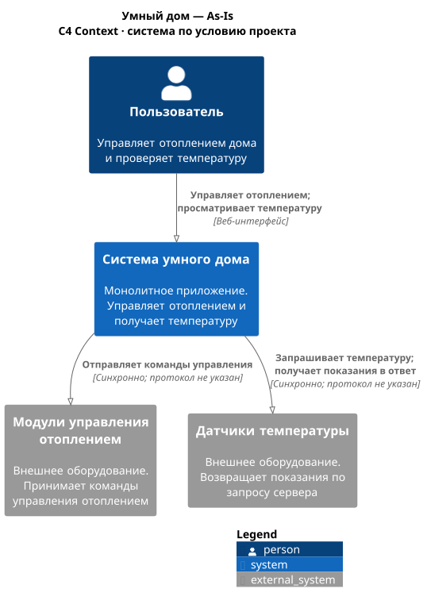

[Исходник PlantUML](schemas/as-is-context.puml).

База данных и внутренние контексты входят в систему и на уровне C4 Context не раскрываются. Датчики и модули управления отоплением показаны как внешнее оборудование; это логические роли, которые могут совмещаться в одном физическом комплекте. Специалист подключает оборудование при установке, но отдельный интерфейс его работы с приложением в условии не описан, поэтому дополнительное программное взаимодействие на диаграмме не вводится.

Диаграмма описывает систему из условия, а не только учебный API: в коде получение температуры идёт через внешний `temperature-api`, а команды отопления не реализованы. Исходная иллюстрация задания сохранена рядом с [описанием текущего решения](docs/project-brief.md#1-текущее-решение) в [docs/img.png](docs/img.png).

# Задание 2. Проектирование микросервисной архитектуры

В этом задании вам нужно предоставить только диаграммы в модели C4. Мы не просим вас отдельно описывать получившиеся микросервисы и то, как вы определили взаимодействия между компонентами To-Be системы. Если вы правильно подготовите диаграммы C4, они и так это покажут.

**Принятое решение:** пять предметных сервисов — устройства, телеметрия, пользователи, сценарии автоматизации и видеонаблюдение — плюс отдельно масштабируемый шлюз интеграций. Отопление, освещение и ворота остаются возможностями общей модели устройств. Видео выделено для независимого масштабирования ожидаемой медианагрузки; регистрация камер и их принадлежность остаются в устройствах. Итого шесть логических сервисов.

Для видеонаблюдения в MVP выбран WebRTC: просмотр в реальном времени без записи и архива, с предпочтительным прямым каналом «камера → браузер» и резервным маршрутом через отдельный TURN-сервер. Сервис видео организует сеанс и проверку доступа; сам медиапоток через него или очереди не проходит. TURN масштабируется отдельно и добавляет расходы на ретранслируемый трафик. Каталог ограничивается совместимыми камерами; конкретные модели, протокол сигнализации партнёра и размещение TURN ещё требуют проверки и детализации. Адаптеры сигнализации находятся в шлюзе интеграций; Video взаимодействует с ними по gRPC. [Границы сервиса видео и компромиссы](docs/to-be-domain-notes.md#видеонаблюдение).

У каждого сервиса собственная модель данных. Для MVP выбрана одна общая БД PostgreSQL с отдельными схемами и ролями доступа сервисов: небольшая команда сохраняет существующую технологию и получает более простую эксплуатацию, принимая общую нагрузку и зависимость от доступности БД. Прямой доступ к таблицам другого сервиса исключён; нужные сведения передаются через межсервисные контракты. Частота опроса, сроки хранения телеметрии и проверка производительности ещё предстоят. [Размещение и границы владения](docs/to-be-domain-notes.md#модели-данных-и-владение).

Для MVP выбран ограниченный каталог совместимых партнёрских комплектов: устройство устанавливает исходящее соединение по MQTT 5 поверх TLS с MQTT-плагином общего RabbitMQ, а облачный шлюз отправляет запросы и команды через подписки. Это сохраняет Pull-опрос и не требует домашнего хаба или облака производителя. Стандартный протокол уменьшает объём собственного протокола доставки для партнёра; форматы команд, показаний и ошибок согласуются отдельно. Поддержка MQTT сама по себе не означает совместимость прибора. [Подключение устройств и компромиссы](docs/to-be-domain-notes.md#подключение-устройств-к-платформе).

Для самостоятельной привязки выбраны секрет из комплекта (QR-код или ручной ввод) и обязательное подтверждение конкретной попытки кнопкой на устройстве. Прибор подтверждает её через собственный аутентифицированный канал; сервис устройств атомарно закрепляет владельца и исключает повторное использование первоначального секрета. Настройка домашнего интернета — отдельный шаг по процедуре партнёра. [Привязка устройства к владельцу](docs/to-be-domain-notes.md#привязка-устройства-к-владельцу).

Для получения измерений и состояний сохраняется фоновый Pull-опрос независимо от пользовательских просмотров. В рабочем варианте телеметрия планирует задания, а шлюз обращается к оборудованию. Согласованы отдельные очереди опроса и управления и пропуск просроченных заданий опроса. Шлюз публикует измерения для независимых подписчиков — телеметрии и сценариев: запись истории не блокирует обработку события сценарием. Экран телеметрии читает сохранённые измерения с временными отметками.

Для масштабирования планировщиков выбрано общее расписание в схеме телеметрии PostgreSQL: экземпляры выбирают разные записи через `FOR UPDATE SKIP LOCKED`, а создание задания в outbox и обновление следующего времени фиксируют одной транзакцией. Relay публикует задания в очередь опросов; блокировки не удерживаются во время сетевых вызовов. [Планирование и компромиссы](docs/to-be-domain-notes.md#распределение-планирования-опросов).

Для одного устройства выбран опрос без накопления и параллельных активных запросов на стороне платформы: пока задание не завершено, новые интервалы пропускаются, после задержек пропущенные опросы не воспроизводятся. Разные устройства обрабатываются параллельно. По таймауту попытка завершается с результатом «ответ не получен», затем назначается новый опрос с паузой, увеличиваемой при последовательных ошибках до предела. Учёт завершения и следующая попытка сохраняются в БД; поздний ответ не завершает новое задание. Принят риск продолжения старой обработки внутри прибора: адаптеры используют существующие протоколы партнёров, гарантированное завершение по нашему сроку от устройств не требуется. На команды управления эта политика не переносится. [Последовательный опрос и восстановление](docs/to-be-domain-notes.md#опрос-без-накопления-и-параллельных-запросов).

Результаты заданий шлюза доставляются отдельно от измерений: результаты опросов — в очередь обработчиков телеметрии, результаты команд — в очередь сервиса устройств. Телеметрия короткой транзакцией учитывает событие в отдельном inbox по `event_id`, проверяет активное задание по `poll_job_id` и актуализирует завершение, занятость устройства и следующее время опроса. Подтверждение RabbitMQ отправляется после commit. Повтор или старое событие не меняют расписание повторно. Запись измерения в историю может происходить независимо и позже. [Обратная доставка результатов](docs/to-be-domain-notes.md#обратная-доставка-результатов-заданий), [inbox результатов опросов](docs/to-be-domain-notes.md#inbox-результатов-опросов).

Для давно незавершённых опросов выбрана периодическая сверка телеметрии со шлюзом по gRPC. Если итог сохранён, шлюз повторно публикует прежнее событие через очередь результатов, без нового физического опроса. Отсутствие итога не снимает занятость автоматически; неразрешённые случаи требуют сигнала оператору. Запрос обслуживает любой экземпляр логического сервиса шлюза по сохранённым данным. [Сверка зависших опросов](docs/to-be-domain-notes.md#сверка-зависших-опросов-со-шлюзом).

После истечения временного права исполнения шлюз закрывает зависший опрос как прерванный и сохраняет результат с outbox. Телеметрия получает его через очередь и inbox, затем планирует новый опрос после паузы; старое задание физически не переисполняется. Версия владения и условный переход состояния защищают результат от поздней записи прежнего исполнителя. Приняты возможный пропуск измерения и отсутствие гарантии физического прекращения старого запроса на устройстве. [Восстановление прерванных опросов](docs/to-be-domain-notes.md#восстановление-прерванных-опросов).

Для команд выбраны постоянный идентификатор при повторах, долговечный учёт состояния и отдельный исход «результат неизвестен». Повтор допустим с учётом возможностей оборудования и актуальности команды; подтверждение очереди не означает физического выполнения. Изменяющие команды одного устройства выполняются последовательно, разных устройств — параллельно. Чтение состояния во время команды допускается по возможностям протокола. При потере результата шлюз автоматически выясняет исход через адаптер; неразрешённые случаи передаются на ручной разбор с сохранением блокировки изменяющих команд устройства. Истечение lease исполнителя и приоритет ручной кнопки эту блокировку не снимают. Детали координации и процедуры для конкретных протоколов ещё предстоит реализовать. [Восстановление команд с неизвестным исходом](docs/to-be-domain-notes.md#восстановление-команд-с-неизвестным-исходом).

Для согласования изменяющих команд экземпляры шлюза используют строку координации на устройство в собственной схеме PostgreSQL. Короткая блокировка строки защищает резервирование и завершение; сохранённая занятость действует между транзакциями и не снимается при неизвестном исходе. Сетевые вызовы выполняются после освобождения SQL-блокировки. Среди допустимых ожидающих команд ручные имеют приоритет и отменяют более старые автоматические команды для той же возможности. Уже зарезервированное исполнение не прерывается; граница отмены сохраняется и учитывает запоздалую доставку. Между ручными командами сохраняется порядок принятия, будущие автоматические действия не запрещаются. [Приоритет ручных команд](docs/to-be-domain-notes.md#приоритет-ручных-команд). [Координация команд](docs/to-be-domain-notes.md#координация-команд-через-строку-устройства).

Команды ожидают исполнения в PostgreSQL шлюза: приёмник идемпотентно сохраняет их по `command_id` и отправляет ACK RabbitMQ после commit приёма. Фоновый исполнитель подбирает допустимые задания, используя строку координации устройства; после ACK за восстановление отвечает шлюз. [Ожидание команд](docs/to-be-domain-notes.md#ожидание-команд-в-postgresql-шлюза).

Для результатов шлюза выбран Transactional Outbox: результат задания и исходящее событие сохраняются одной транзакцией. Входное задание опроса подтверждается после commit результата; для команд ACK уже отправлен после сохранения самой команды. Фоновый компонент публикует сохранённое событие в брокер. Повторная доставка возможна; потребители должны учитывать `event_id`. Это не устраняет неопределённость при сбое между действием устройства и сохранением результата. Для результатов команд выбрана возрастающая версия состояния: шлюз сохраняет состояние, версию и outbox атомарно, а сервис устройств атомарно проверяет версию и не позволяет запоздалому событию перезаписать более новый статус. [Версия состояния команды](docs/to-be-domain-notes.md#версия-состояния-команды).

Сценарии сохраняют учёт обработанного события, состояние правила, срабатывание и исходящую команду одной транзакцией с inbox/outbox. Для обработки каждого правила выбрана отдельная короткая транзакция с блокировкой его строки в PostgreSQL; разные правила обрабатываются параллельно. Редактирование и отключение используют ту же координацию, сетевые вызовы выполняются вне блокировки. [Конкурентная обработка правила](docs/to-be-domain-notes.md#конкурентная-обработка-одного-правила). Устройства принимают команды идемпотентно по `command_id` и сохраняют принятую команду, её порядок и задание шлюзу в собственном outbox одной транзакцией. Первое свежее измерение после включения нового правила вызывает действие, если условие истинно; далее простые пороговые триггеры срабатывают при переходе из ложного в истинное. Изменение условия создаёт новую версию с начальной проверкой; перезапуск сервиса восстанавливает прежнее состояние. При потере свежих данных действия не создаются, последнее состояние сохраняется; восстановление связи само по себе не повторяет команду. Повтор по таймеру задаётся отдельно. [Решение и границы гарантий](docs/to-be-domain-notes.md#надёжное-срабатывание-сценариев-и-приём-команд).

Для внутренних заданий и событий выбран RabbitMQ: отдельные очереди опроса и управления, exchange событий измерений с отдельными очередями телеметрии и сценариев. Повторы обрабатываются через ранее выбранные inbox/outbox и идентификаторы. Протокол устройств этим не определяется, видео через брокер не передаётся. [Выбор брокера и компромиссы](docs/to-be-domain-notes.md#брокер-внутренних-заданий-и-событий).

Для запросов между сервисами выбран gRPC с Protocol Buffers. Телеметрия получает конфигурации устройств через gRPC; отправитель outbox сценариев передаёт команды сервису устройств тем же способом, сохраняя `command_id` при повторах. Подтверждение приёма не означает физического выполнения; задания шлюзу и события остаются в RabbitMQ. Для пользовательского клиента отдельно выбран HTTP/JSON поверх HTTPS через API Gateway. [Межсервисные API](docs/to-be-domain-notes.md#запросные-межсервисные-api).

В MVP используется один общий RabbitMQ с vhost `devices` для MQTT и `internal` для внутренних сообщений. Шлюз проверяет данные между областями; устройства не имеют доступа к внутренним очередям. Для последующего разделения настройки подключений независимы, MQTT-вход имеет стабильное DNS-имя. Общие ресурсы и область отказа принимаются как компромисс MVP; миграция сеансов и сообщений при масштабировании потребует отдельного плана.

[Границы ответственности, связь As-Is с To-Be и рассмотренные альтернативы](docs/to-be-domain-notes.md#декомпозиция-на-микросервисы-задание-2). Диаграммы задания 2 приведены ниже. Они описывают целевую архитектуру; переходное состояние и миграция относятся к заданию 6. Детальные контракты, конфигурация ресурсов и проверка совместимости оборудования остаются последующей работой.

Для всех сервисов, проверяющих доступ к устройствам, выбран общий внешний кэш только положительных результатов авторизации с ограниченным сроком. Сервис устройств остаётся источником владения и единственным писателем разрешений в кэш; остальные сервисы-потребители имеют доступ только на чтение. При отсутствии действующего результата выполняется gRPC-проверка. Принято окно устаревшего разрешения до истечения TTL; значение TTL и технология кэша ещё не выбраны. Отказы не кэшируются; отсутствие записи требует проверки у источника, а не автоматического запрета. При недоступности кэша проверка выполняется напрямую у сервиса устройств; невозможность записать полученное разрешение в кэш не блокирует запрос. Если нет действующего разрешения и источник недоступен, возвращается временная недоступность проверки. Проверки сессии и подлинности токенов этим решением не заменяются. [Кэширование проверок доступа](docs/to-be-domain-notes.md#кэширование-проверок-доступа-к-устройствам).

[Рабочая схема шлюза и очередей](docs/to-be-domain-notes.md#рабочая-схема-шлюза-и-очередей) показывает обсуждаемый фрагмент; она не заменяет итоговые диаграммы C4.

Для управления по текущему состоянию принимаются только более новые и достаточно свежие измерения, без ожидания переупорядочивания. Запоздавшие корректные измерения сохраняются в истории, но не возвращают сценарий к старому состоянию. Для MVP принято допущение о надёжных часах устройств: порядок и возраст определяются по времени измерения `measured_at`, при согласованных часах серверов. Допустимый возраст задаётся для правила; конкретные значения ещё не выбраны. [Политика и ограничения](docs/to-be-domain-notes.md#порядок-и-свежесть-измерений).

**Диаграмма контекста (Context)**

Целевая платформа как единая система, её пользователи, оборудование и диагностические клиенты. Это To-Be Context задания 2; As-Is Context задания 1 сохраняется отдельно.

[PlantUML](schemas/to-be-context.puml) · [Открыть SVG](schemas/to-be-context.svg).

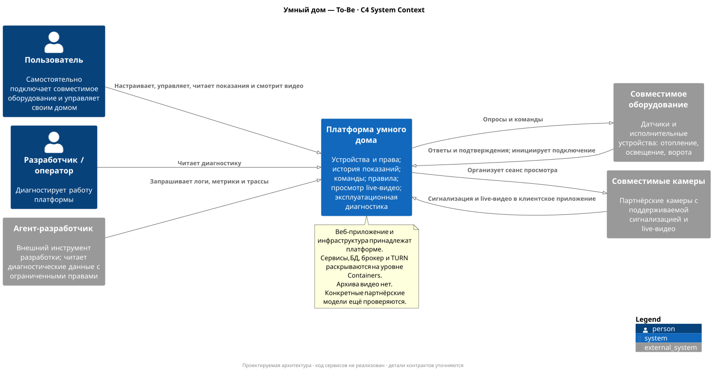

**Диаграмма контейнеров (Containers)**

Для MVP принят один владелец дома и устройств, без совместного доступа и ролей членов семьи. Управление, телеметрия, видео и сценарии ограничены ресурсами владельца. Основание — отсутствие требования совместного доступа в исходном задании. [Границы доступа](docs/to-be-domain-notes.md#владение-и-доступ-в-mvp).

Выбран единый API Gateway для пользовательских API; шлюз интеграций с оборудованием остаётся отдельным контейнером. Между браузером и Gateway выбран HTTP/JSON поверх HTTPS, внутри — gRPC; требуется преобразование запросов и ответов на границе. Для пользователя выбрана серверная сессия в защищённой cookie, проверяемая Gateway через сервис пользователей; состояние хранится в схеме пользователей PostgreSQL. Жёсткой привязки к IP нет. Для API Gateway выбраны PHP и Laravel с жизненным циклом приложения на один запрос; конфигурация запуска и первоначальный вход ещё обсуждаются. [Сессии и принятые риски](docs/to-be-domain-notes.md#пользовательские-сессии). После проверки сессии сервис пользователей выдаёт короткоживущий подписанный токен для целевого сервиса; Gateway передаёт его по gRPC/TLS, получатель проверяет токен и права на ресурс. [Внутренний контекст и ограничения](docs/to-be-domain-notes.md#подписанный-внутренний-контекст-пользователя). Все целевые сервисы проектируются с учётом Twelve-Factor App: конфигурация окружения отделена от кода, долговечное состояние вынесено из процессов, предусмотрены независимое масштабирование и восстановление. Это требования к будущей реализации, не результат её проверки. [Вход приложения](docs/to-be-domain-notes.md#вход-пользовательского-приложения), [применение двенадцати факторов](docs/to-be-domain-notes.md#требования-twelve-factor-app).

[Исходник PlantUML](schemas/to-be-containers.puml) · [Открыть SVG](schemas/to-be-containers.svg).

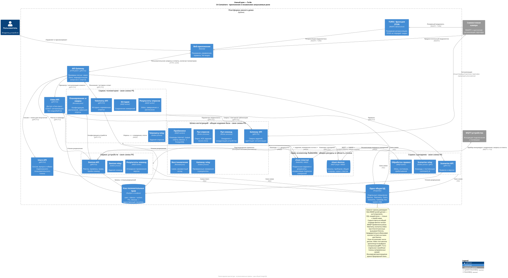

Границы сервисов объединяют независимо запускаемые роли; они не обозначают количество реплик или отдельные серверы. PostgreSQL одна, схемы и роли раздельные. Два vhost принадлежат одному RabbitMQ. Стрелки SQL от границ сервисов суммируют доступ их ролей только к своей схеме. У Video постоянное хранилище сеансов пока не выбрано.

Показания и история возвращаются браузеру **через API Gateway**. Фоновый сбор не зависит от открытого приложения. Для последующего пользовательского вызова выбран [обмен внутреннего токена](docs/to-be-domain-notes.md#передача-пользователя-следующему-сервису). [Сигнализация камер](docs/to-be-domain-notes.md#сигнализация-партнёрских-камер) проходит через адаптер шлюза по существующему протоколу партнёра; только медиапоток идёт прямо или через TURN.

Сырые MQTT-ответы распределяются [общей AMQP-очередью в devices](docs/to-be-domain-notes.md#распределение-и-долговечный-приём-сырых-ответов). Приёмник сохраняет ответ с корреляцией в PostgreSQL до ACK; это не завершение задания. Для опросов и команд выбраны [отдельные пулы исполнителей](docs/to-be-domain-notes.md#процессы-и-представление-c4) общей кодовой базы шлюза.

Для gRPC-вызовов во внутренней сети выбраны отдельные служебные токены для каждой разрешённой связи поверх TLS. Они подтверждают сервис-отправитель независимо от подписанного пользовательского контекста. Конфигурация передаётся через окружение; токены не привязаны к IP экземпляров. Приняты риски использования украденного токена до замены и необходимость согласованной ротации. [Служебная аутентификация](docs/to-be-domain-notes.md#аутентификация-сервисов-во-внутренней-сети).

Для шлюза интеграций выбран **Elixir / Erlang OTP**: конкурентные обработчики и управление их восстановлением при сохранении PostgreSQL, RabbitMQ и согласованных границ ACK. Критичных препятствий по документации не выявлено; работоспособность конкретного стека и камер ещё не проверена. [Основания выбора, риски и границы проверки](docs/to-be-domain-notes.md#язык-шлюза-интеграций-elixir). Для Devices выбран **Kotlin/JVM**: постоянно работающий gRPC API, отдельные роли обработки результатов и outbox, транзакции своей схемы PostgreSQL и запись положительных разрешений во внешний кэш. [Основания и границы выбора](docs/to-be-domain-notes.md#язык-сервиса-устройств-kotlin). Для **Telemetry выбран Go**, для **Scenarios — Python**: [основания выбора Go](docs/to-be-domain-notes.md#язык-сервиса-телеметрии-go), [основания выбора Python](docs/to-be-domain-notes.md#язык-сервиса-сценариев-python). Go выбран под ожидаемый постоянный поток обработки; измерениями преимущество ещё не подтверждено. Для **API Gateway выбран PHP**: [основания и границы выбора](docs/to-be-domain-notes.md#язык-api-gateway-php). TypeScript рассматривался как альтернатива. Для **Users выбран C#**: [основания и границы выбора](docs/to-be-domain-notes.md#язык-сервиса-пользователей-c). Для **Video выбран TypeScript / Node.js**: [основания и границы выбора](docs/to-be-domain-notes.md#язык-сервиса-видеонаблюдения-typescript). Языки всех шести сервисов и API Gateway согласованы. [Уточнение кандидатов](docs/to-be-domain-notes.md#уточнение-кандидатов-для-users-и-api-gateway). Перед детализацией C4 Code согласованы фреймворки либо их отсутствие: [стратегия повторного использования и кандидаты](docs/to-be-domain-notes.md#стратегия-выбора-фреймворков-перед-c4-code). Для Devices принят [Spring Boot](docs/to-be-domain-notes.md#фреймворк-devices-spring-boot), для Users — [ASP.NET Core gRPC](docs/to-be-domain-notes.md#фреймворк-users-aspnet-core-grpc), для Video — [NestJS с gRPC transport](docs/to-be-domain-notes.md#фреймворк-video-nestjs), для API Gateway — [Laravel с жизненным циклом приложения на один запрос](docs/to-be-domain-notes.md#фреймворк-api-gateway-laravel). Для Telemetry принят [Go с gRPC-Go без общего прикладного фреймворка](docs/to-be-domain-notes.md#основа-telemetry-go-и-grpc-go), для шлюза интеграций — [Elixir/OTP без дополнительного веб-фреймворка](docs/to-be-domain-notes.md#основа-integration-gateway-elixir-и-otp). Для Scenarios принят [gRPC Python без общего веб-фреймворка](docs/to-be-domain-notes.md#основа-scenarios-python-и-grpc-python). Выбор основ всех сервисов завершён. Документационное ревью по Twelve-Factor App не выявило оснований менять стеки; запуск HTTP-слоя Laravel и восстановление управляющего сеанса Video требуют последующей детализации. Соответствие реализации ещё не проверено.

Отдельно задано [требование наблюдаемости и доступа для агента](docs/to-be-domain-notes.md#требование-наблюдаемости-и-доступа-для-агента): логи, метрики и трассы всех сервисов и фоновых ролей, корреляция через outbox/очереди, инфраструктурные exporters, дашборды и машинный доступ к диагностике. Зафиксированы критерии приёмки. Принято [OpenTelemetry для распределённой трассировки и переноса контекста](docs/to-be-domain-notes.md#принято-opentelemetry-для-распределённой-трассировки). Выбран [OpenTelemetry Collector](docs/to-be-domain-notes.md#принято-opentelemetry-collector): наличие CLI подтверждено, поиск сохранённых данных требует отдельного интерфейса хранилищ. Принят [Prometheus с собственным хранилищем эксплуатационных метрик](docs/to-be-domain-notes.md#принято-prometheus-для-эксплуатационных-метрик), с HTTP API и promtool для агента. Принят [Loki для логов с LogCLI и HTTP API](docs/to-be-domain-notes.md#принято-loki-для-логов). Tempo, Grafana и Grafana MCP остаются кандидатами; их выбор отложен. Развёртывания и runtime-проверок нет.

**Containers: наблюдаемость**

Отдельный эксплуатационный срез той же платформы: принятые Collector, Prometheus и Loki, все роли сервисов и инфраструктура. Хранилище трасс явно показано как открытый выбор; сводные узлы не добавляют новых предметных сервисов.

[PlantUML](schemas/to-be-containers-observability.puml) · [Открыть SVG](schemas/to-be-containers-observability.svg).

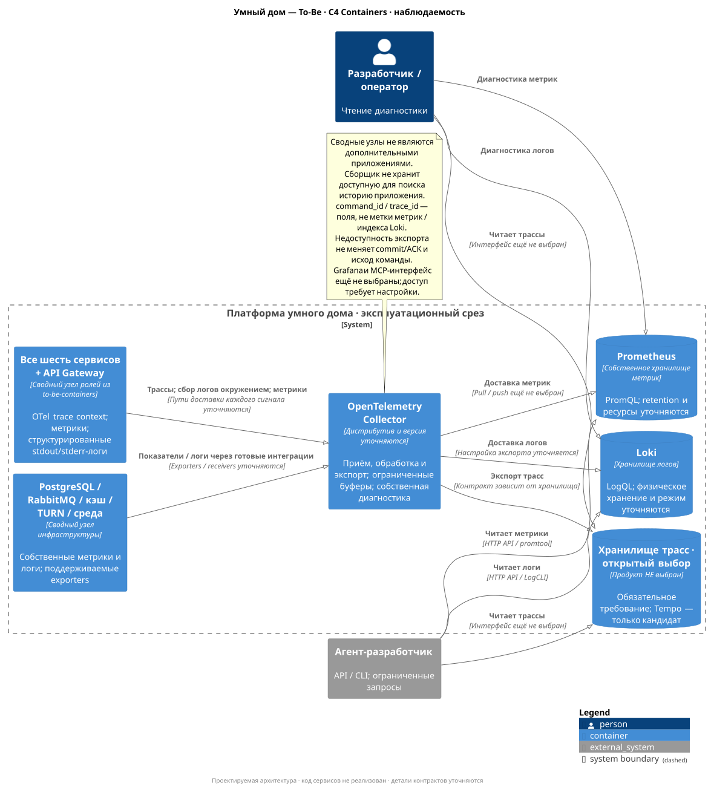

**Диаграмма компонентов (Components)**

В каждой схеме показаны проектируемые компоненты и границы процессов одного сервиса. Внешние участники дают контекст. Узлы схем данных относятся к одной общей PostgreSQL; это не отдельные экземпляры СУБД.

**Устройства**

[PlantUML](schemas/to-be-components-devices.puml) · [Открыть SVG](schemas/to-be-components-devices.svg).

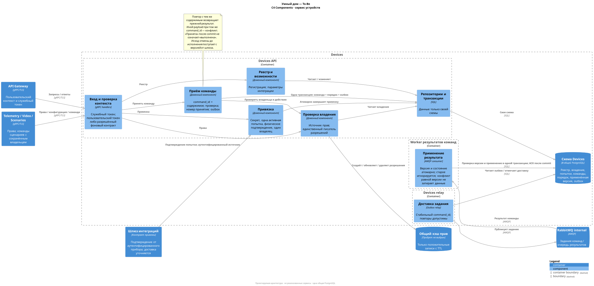

**Телеметрия**

[PlantUML](schemas/to-be-components-telemetry.puml) · [Открыть SVG](schemas/to-be-components-telemetry.svg).

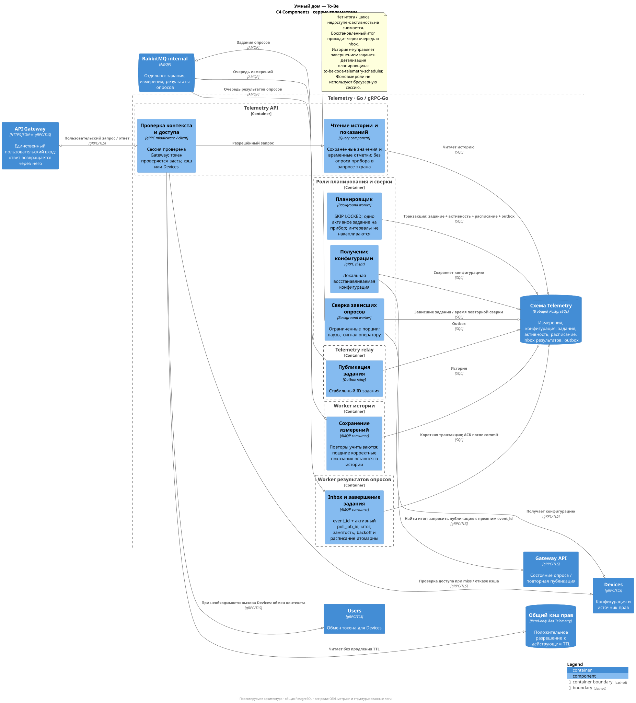

**Пользователи**

[PlantUML](schemas/to-be-components-users.puml) · [Открыть SVG](schemas/to-be-components-users.svg).

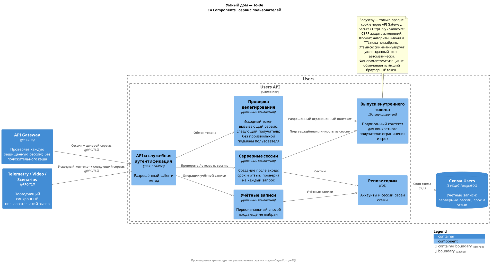

**Сценарии**

[PlantUML](schemas/to-be-components-scenarios.puml) · [Открыть SVG](schemas/to-be-components-scenarios.svg).

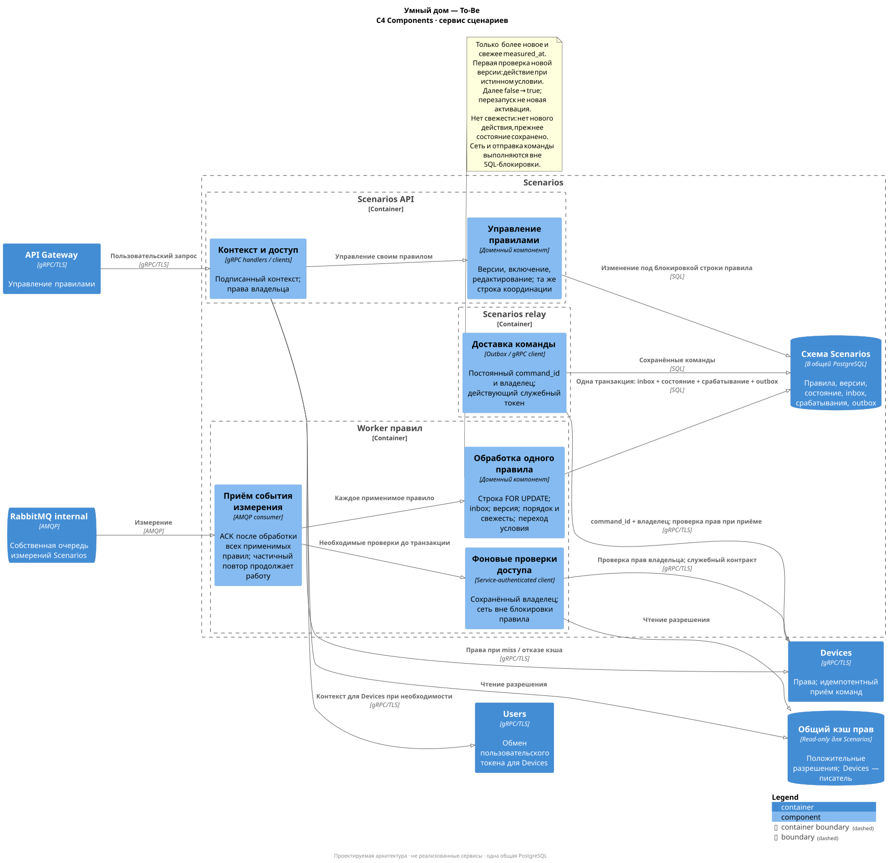

**Видеонаблюдение**

[PlantUML](schemas/to-be-components-video.puml) · [Открыть SVG](schemas/to-be-components-video.svg).

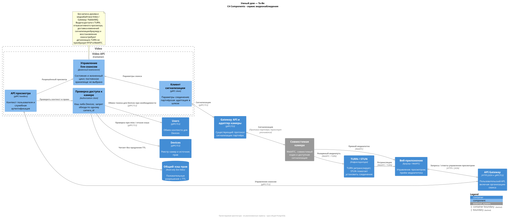

**Шлюз интеграций**

[PlantUML](schemas/to-be-components-integration-gateway.puml) · [Открыть SVG](schemas/to-be-components-integration-gateway.svg).

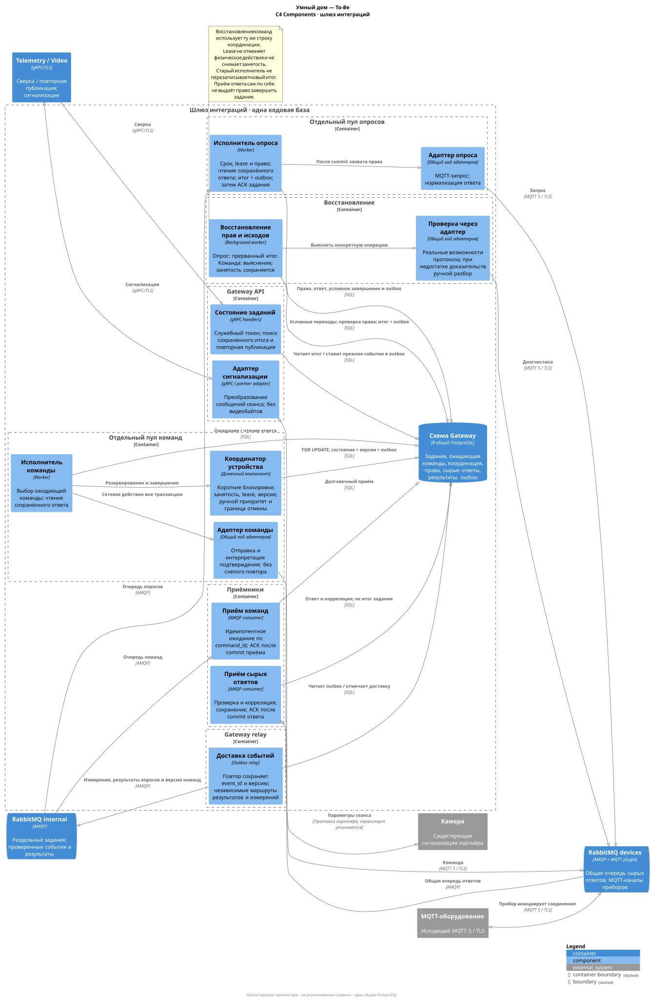

**Пользовательский API Gateway**

[PlantUML](schemas/to-be-components-api-gateway.puml) · [Открыть SVG](schemas/to-be-components-api-gateway.svg).

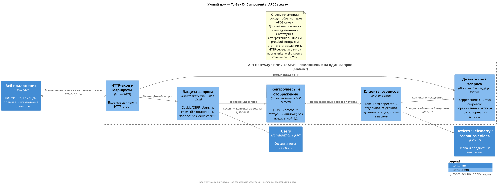

**Диаграммы кода (Code)**

Четвёртый уровень раскрывает классы, структуры, функции и модули **четырёх критичных компонентов** на выбранных стеках. Это проектируемая структура: названия элементов и сокращённые сигнатуры не являются существующими исходниками или окончательными API-контрактами. Серые элементы дают контекст соседних компонентов. UML-блок с Elixir-модулем или Go-функцией не означает превращение языка в ООП-каркас.

| Компонент уровня Components | Язык / основа | Детализация Code |
| --- | --- | --- |
| Devices: приём команд | Kotlin / Spring Boot | Проверка, идемпотентный приём, транзакция команды/порядка/outbox |
| Telemetry: планировщик | Go / gRPC-Go | Сборка зависимостей, готовность конфигурации, порция расписания и одна активная работа |
| Scenarios: обработка одного правила | Python / gRPC Python | Проверка до блокировки, актуальная версия, вычисление перехода и inbox/state/outbox |
| Integration Gateway: координатор устройства | Elixir / OTP | Право исполнения, ручной приоритет, неизвестность и подтверждённое освобождение |

**Devices: приём команды**

[PlantUML](schemas/to-be-code-devices-command.puml) · [Открыть SVG](schemas/to-be-code-devices-command.svg).

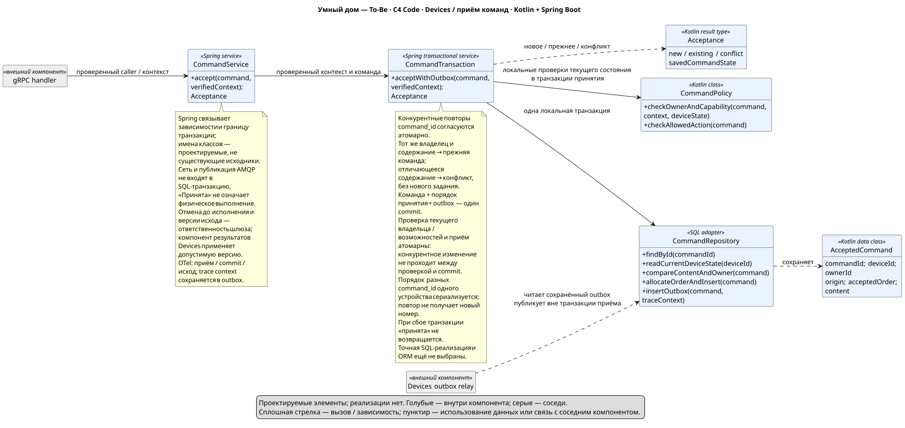

**Telemetry: планировщик**

[PlantUML](schemas/to-be-code-telemetry-scheduler.puml) · [Открыть SVG](schemas/to-be-code-telemetry-scheduler.svg).

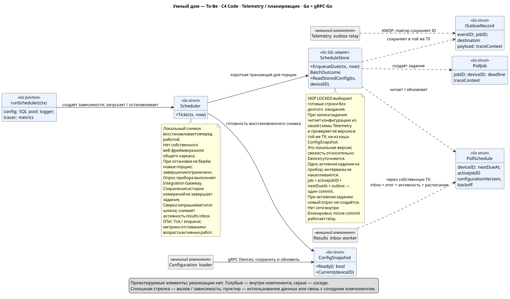

**Scenarios: обработка правила**

[PlantUML](schemas/to-be-code-scenarios-rule.puml) · [Открыть SVG](schemas/to-be-code-scenarios-rule.svg).

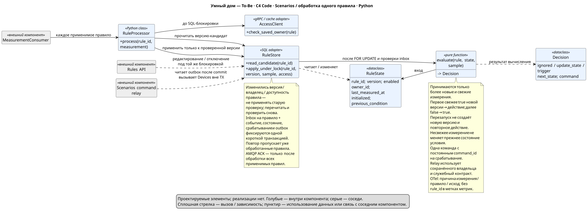

**Integration Gateway: координатор команды**

[PlantUML](schemas/to-be-code-gateway-coordinator.puml) · [Открыть SVG](schemas/to-be-code-gateway-coordinator.svg).

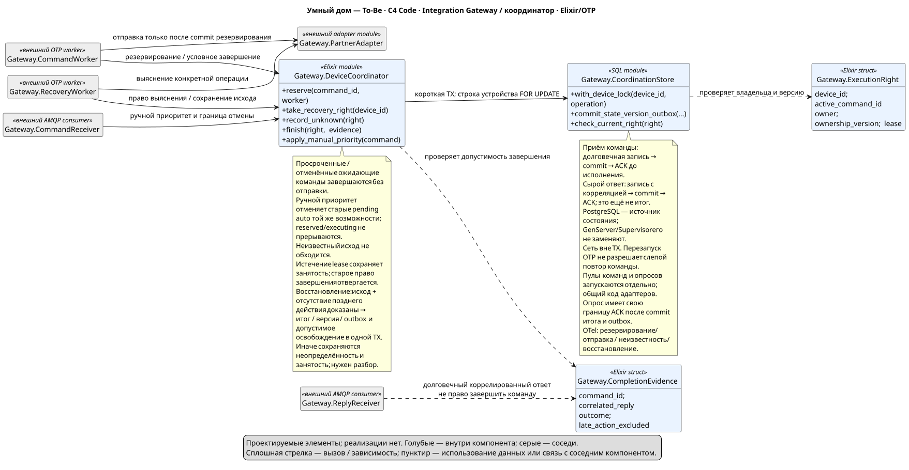

Code раскрывает только наиболее сложные компоненты, как рекомендует [C4 model](https://c4model.com/diagrams/code). Users, Video и API Gateway раскрыты на уровне Components; их полная классовая модель не нужна для этих алгоритмов. Сохраняются штатные механизмы выбранных фреймворков и профильных библиотек; общий самописный каркас не вводится.

**Критичные взаимодействия (Sequence, дополнение к C4)**

Ниже показано проектируемое поведение, а не трассы работающей реализации. Sequence дополняют структурные уровни C4. Транзакции локальны; сетевые вызовы выполняются вне SQL-блокировок.

**Опрос, независимые подписчики и срабатывание правила**

[PlantUML](schemas/to-be-sequence-automation.puml) · [Открыть SVG](schemas/to-be-sequence-automation.svg).

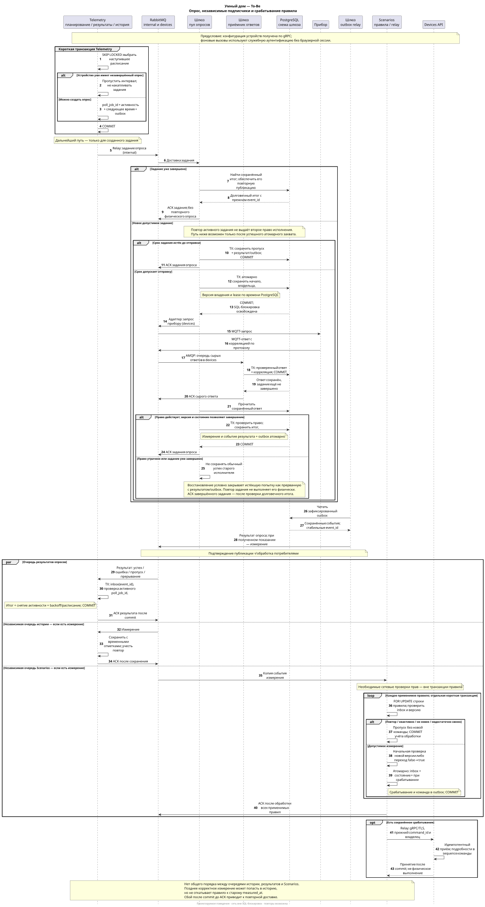

**Приём, ожидание, исполнение команды и версия результата**

[PlantUML](schemas/to-be-sequence-command.puml) · [Открыть SVG](schemas/to-be-sequence-command.svg).

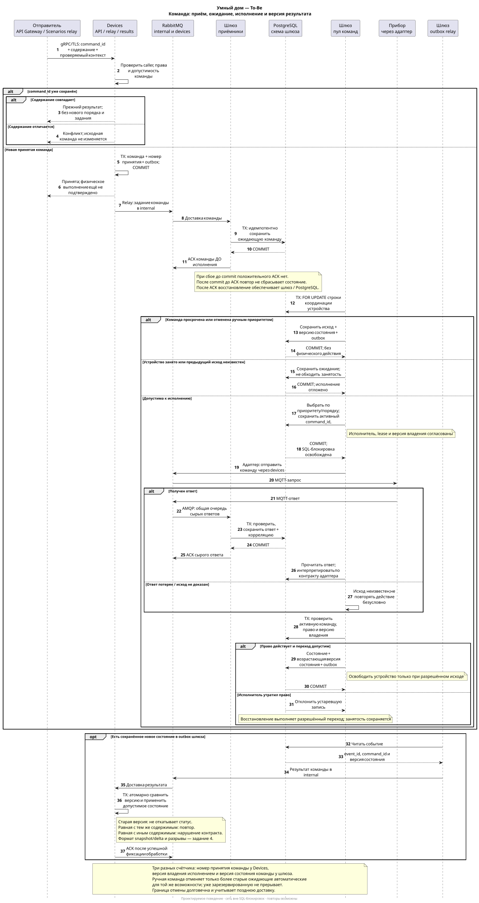

**Восстановление неизвестного исхода команды**

[PlantUML](schemas/to-be-sequence-command-recovery.puml) · [Открыть SVG](schemas/to-be-sequence-command-recovery.svg).

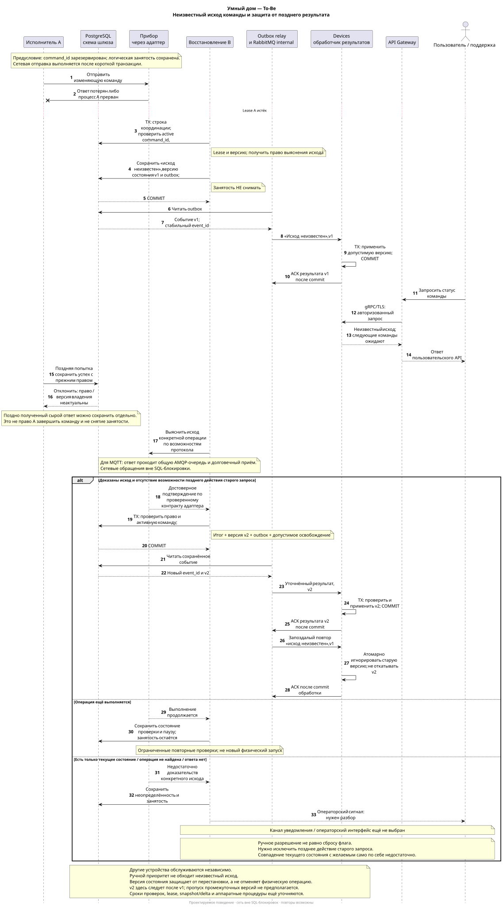

ACK команды после приёма, ACK сырого ответа после его сохранения и ACK опроса после итога — разные этапы. Повторы доставки допустимы. Неизвестный исход команды и истечение lease не освобождают устройство; версия состояния защищает от запоздалого события, но не гарантирует однократное физическое действие. Формат snapshot/delta и правила разрывов версий ещё не определены.

**Итог задания 2:** оформлены все четыре уровня To-Be C4 — Context, Containers, Components и Code — и три sequence-схемы. Всего 17 исходников PlantUML и соответствующих SVG. Задание завершено в объёме архитектурных диаграмм; микросервисы ещё не реализованы.

**Последующая детализация:** первоначальный вход, runtime и граница HTTP-поставки Laravel, хранение/восстановление управления Video, конкретные камеры, продукт кэша и TTL, версии библиотек, DDL и точные API-контракты, параметры брокера и наблюдаемости. Tempo/Grafana/MCP не утверждены. Эти вопросы отмечены явно; диаграммы не обещают проверенной совместимости или runtime-соответствия Twelve-Factor.

**Проверки:** PASS — локальный рендер и визуальная проверка, ссылки, согласованность уровней и границ ACK, `git diff --check`. Runtime, интеграционные, отказные, нагрузочные и аппаратные проверки — **NOT RUN**. Код сервисов и задания 3–6 в этот этап не входят.

# Задание 3. Разработка ER-диаграммы

Логическая модель **целевой** системы продолжает границы сервисов задания 2. Она показывает предметные сущности, атрибуты, обязательность и кратности связей. Это результат проектирования, а не схема существующего монолита или готовые миграции.

[Исходник PlantUML](schemas/to-be-er.puml) · [SVG для просмотра с увеличением](schemas/to-be-er.svg)

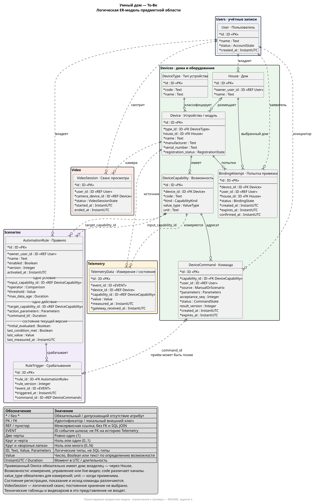

### Сущности и владельцы данных

| Контекст | Сущности | Ответственность |
| --- | --- | --- |
| Users | `User` | Идентификатор, имя, состояние аккаунта и время создания. Способ входа не выбирается этой моделью |
| Devices | `House`, `DeviceType`, `Device`, `DeviceCapability` | Дома и их владельцы, категории оборудования, реестр приборов и возможности отдельных каналов |
| Devices | `BindingAttempt`, `DeviceCommand` | Попытки привязки к выбранному дому и команды с параметрами, источником, порядком принятия и версией результата |
| Telemetry | `TelemetryData` | Значение конкретной возможности, источник, идентификатор события и раздельные моменты измерения и получения шлюзом |
| Scenarios | `AutomationRule`, `RuleTrigger` | Одно условие и одно действие, владелец, версия и сохранённое состояние правила; история срабатываний и идентификаторы исходящих команд |
| Video | `VideoSession` | Пользователь, камера, состояние и время live-сеанса. Постоянное хранение сеанса этой моделью не утверждается |

Атрибуты приведены на диаграмме. `*` означает обязательность, отсутствие звёздочки — возможность отсутствия значения. `ID`, `Text`, `Integer`, `Boolean`, `InstantUTC` и `Duration` — логические типы; физические SQL-типы, форматы идентификаторов и индексы не выбираются. `Value` содержит число, логическое или текстовое значение согласно `value_type` возможности; `Parameters` — параметры соответствующей команды, а не назначенный формат JSON/SQL. Типы состояний описывают разные жизненные циклы; полный перечень переходов будет уточняться при реализации контрактов.

`PK` обозначает идентификатор сущности, `FK` — связь внутри одного сервиса, `REF` — межсервисную ссылку. Сплошные линии показывают локальные FK, пунктир — логические связи. Выбранная архитектура запрещает межсервисные FK, SQL JOIN и доступ к чужой схеме даже в общей PostgreSQL. Изоляцию доступа предстоит обеспечить отдельными ролями и [правами на схемы и объекты](https://www.postgresql.org/docs/16/ddl-schemas.html#DDL-SCHEMAS-PRIV). Пометка `EVENT` относится к событию шлюза, а не к внешнему ключу на `TelemetryData`.

### Связи и ограничения

| Связь | Кратность и смысл |
| --- | --- |
| `User → House` | У пользователя 0..N домов, у дома ровно один владелец |
| `House → Device` | В доме 0..N приборов; у прибора 0..1 дома до привязки и ровно один после её завершения |
| `DeviceType → Device` | У типа 0..N приборов, у каждого прибора ровно один тип |
| `Device → DeviceCapability` | У прибора 0..N зарегистрированных возможностей, каждая относится ровно к одному прибору. Прибор без возможностей ещё нельзя опрашивать или использовать как адресат действия |
| `Device / House / User → BindingAttempt` | У каждого участника 0..N попыток в истории; попытка ссылается ровно на один прибор, выбранный дом и заявителя |
| `DeviceCapability / User → DeviceCommand` | Возможность и инициатор имеют 0..N команд; каждая команда адресована одной управляемой возможности от имени одного пользователя |
| `Device / DeviceCapability → TelemetryData` | У источника и измеряемой возможности 0..N измерений; запись содержит по одному идентификатору прибора и его возможности |
| `User / DeviceCapability → AutomationRule` | У владельца 0..N правил; возможность может использоваться в 0..N правилах. Каждое правило имеет одного владельца, одну входную и одну целевую возможность |
| `AutomationRule → RuleTrigger` | У правила 0..N срабатываний, каждое относится к одному правилу и сохраняет номер сработавшей версии |
| `RuleTrigger ↔ DeviceCommand` | Срабатывание сразу получает один постоянный `command_id`, но соответствующая запись Devices может ещё отсутствовать. Одной команде соответствует 0..1 срабатывания: у ручной команды его нет |
| `User / Device → VideoSession` | У пользователя и камеры 0..N сеансов; каждый сеанс относится к одному пользователю и одному устройству с возможностью live-видео |

**Владение и привязка.** Источник владельца устройства — `House.owner_user_id` через `Device.house_id`; отдельного `Device.owner_user_id` нет. `BindingAttempt.user_id` обозначает претендента, а `DeviceCommand.user_id` — инициатора команды, не дополнительного текущего владельца. До привязки прибор может не иметь дома и владельца. Для устройства допускается не более одной активной попытки; её завершение атомарно проверяет срок, физическое подтверждение, отсутствие действующей привязки и принадлежность выбранного дома заявителю, затем назначает дом. `confirmed_at` отсутствует до подтверждения. Секрет из комплекта и учётные данные прибора остаются частью согласованного процесса подключения, но их техническое хранение здесь не раскрывается.

**Возможности и значения.** `DeviceType` — категория, например термостат; `DeviceCapability` описывает конкретные измерения, управление или live-видео. `code` различает возможности и каналы внутри устройства. Для измеряемой возможности обязателен `value_type`; `unit` заполняется только при наличии единицы измерения. Температура может иметь числовое значение в °C, состояние переключателя — Boolean, положение ворот — текстовое значение. У видео нет скалярного показания; поток не сохраняется в `TelemetryData`. Пара `device_id` и `capability_id` в событии должна обозначать один источник; проверка использует межсервисный контракт, не SQL JOIN с Devices. Область уникальности серийных номеров производителей этой моделью не определяется.

**Команды и показания.** `registration_status` описывает подключение и привязку, а не «включено/выключено». Сообщённое прибором состояние находится в телеметрии; исход команды — в `DeviceCommand.status`. `acceptance_seq` назначается принятой команде в рамках устройства, определяемого через её возможность; у отклонённой команды номера нет. `result_version` отсутствует до первого результата шлюза. Повтор с тем же ID и содержимым возвращает прежний результат; иной payload с тем же ID — конфликт. Приём команды не доказывает её физическое выполнение.

**Автоматизация.** Вход правила — измеряемая возможность, выход — управляемая. Обе принадлежат владельцу правила через свои дома; нахождение в одном доме не требуется. Оператор и порог должны соответствовать типу значения. `max_data_age` ограничивает возраст измерения. В задании 4 добавлен `command_ttl` — срок актуальности команды от момента срабатывания; API передаёт обе длительности в миллисекундах. `activated_at` отсутствует до первой активации версии и обязателен для активного правила. `initial_evaluated`, `last_condition_met`, `last_value` и `last_measured_at` сохраняют состояние текущей версии; до первой подходящей проверки последние значения отсутствуют. Первое свежее измерение после активации версии запускает действие, если условие истинно; далее нужен переход false → true. Перезапуск сервиса не сбрасывает это состояние. Срабатывание фиксирует намерение отправить команду, не её выполнение. Его `event_id` поступает из независимой подписки на события шлюза: запись истории Telemetry может появиться позже и не нужна для обработки правила. Номер версии в срабатывании не означает, что здесь спроектирован полный архив конфигураций правил.

**Видео и границы модели.** Доступ к камере проверяется через Devices; `ended_at` отсутствует у незавершённого сеанса. Видеоархива нет. Удаление объектов, хранение исторических ссылок, передача владения, отзыв активного просмотра и судьба ранее принятых команд требуют отдельной детализации; межсервисные каскады не вводятся. На диаграмме не раскрываются серверные сессии, секреты, inbox/outbox, задания опросов и координация шлюза. Их отсутствие в предметном представлении не отменяет решений задания 2. API Gateway и шлюз интеграций не получают дополнительных предметных сущностей только ради присутствия на ER.

### Решения и рассмотренные альтернативы

| Выбор | Альтернатива и основание |
| --- | --- |
| Модуль — экземпляр `Device` | Отдельный контроллер `Module` потребовал бы раздельного учёта приборов за ним. Для выбранного MVP достаточно формулировки условия «модули (устройства)» |
| Дом обязателен после привязки | Необязательный дом позволял бы отдельные приборы аккаунта, но создавал бы второй способ организации оборудования |
| Владелец определяется через дом | Дублирование владельца в `Device` упростило бы отдельную проверку, но потребовало бы постоянно согласовывать две записи |
| Возможности задаются у прибора | Фиксированный набор у типа компактнее, но плохо описывает отличающиеся каналы и комплектации партнёров |
| Одно условие и одно действие | Составные правила требуют групп AND/OR и политики выполнения нескольких действий. Для начальных пороговых автоматизаций выбраны независимые правила |
| Предметная ER-модель | Полная физическая модель включала бы технические таблицы всех сервисов. Здесь сохранены ключевые сущности и границы без проектирования DDL |

### Проверка модели на примерах

| Пример | Что должна выражать модель |
| --- | --- |
| Один пользователь, квартира и дача | Две `House` с одним `owner_user_id`; устройства распределены между ними |
| Новый непривязанный прибор | `Device.house_id` отсутствует; попытка содержит выбранный дом и заявителя, но ещё не наделяет его владением |
| Термостат | Один `Device` и отдельные возможности измерения температуры и управления нагревом; два канала реле также различаются возможностями |
| История измерений | Несколько `TelemetryData` одной возможности, включая позднее корректное измерение; `measured_at` не подменяется временем получения |
| Включение отопления ниже 18 °C | Одно правило с порогом 18 и действием включения; срабатывание сохраняет версию, событие и постоянный ID команды. Выключение выше 20 °C — другое правило |
| Просмотр камеры | `VideoSession` ссылается на владельца и камеру; повторные просмотры создают отдельные сеансы, видеоархив не появляется |

**Проверки — PASS:** SVG и временный PNG построены локально через PlantUML 1.2024.3 (headless, UTF-8, Smetana, `-failfast2`); итоговый PNG просмотрен. Проверены SVG/XML, наличие 11 сущностей и их атрибутов, локальность FK, межсервисные ссылки, кратности, шесть приведённых примеров, ссылки и якоря документации, `git diff --check`. Это статическая проверка модели. **Runtime — NOT RUN:** сервисы и миграции в этом задании не реализовывались.

# Задание 4. Создание и документирование API

### 1. Тип API

Сохраняется выбранное разделение: **HTTP/JSON через API Gateway** документируется в OpenAPI 3.1.1; **gRPC/Protocol Buffers** описывает синхронные межсервисные вызовы; **RabbitMQ/AsyncAPI 3.0.0** — задания и события. Приём команды не равен её физическому выполнению. Внутренний gRPC не подменяется HTTP-описанием.

По согласованию объём расширен сверх 4–5 операций для полного потока телеметрии, управления и автоматизации: 8 HTTP-операций, 16 RPC и 5 семейств сообщений. Предполагаются вошедший пользователь, привязанное устройство и зарегистрированные возможности; вход, привязка, дома и видео остаются за границей этого среза. Сервисы не реализуются в задании 4.

Приняты полный снимок результата команды с возрастающей версией, снимок конфигурации без секретов в задании и новая активация при повторном включении правила. [Причины выбора и альтернативы](docs/api/README.md#выбор-типов-api), [детальные правила](docs/api/contracts.md).

### 2. Документация API

**[Вход в документацию и локальный интерактивный просмотр](docs/api/README.md)**

| Контракт | Документация |
| --- | --- |
| Устройства, история, команды, правила и срабатывания | [OpenAPI](docs/api/openapi.yaml), Swagger UI через локальную сборку |
| Users, Devices, Telemetry, Scenarios, Integration Gateway | [Protocol Buffers](docs/api/proto/warmhouse.proto), [справочник RPC и HTTP mapping](docs/api/grpc.md) |
| Опросы, измерения и результаты | [Telemetry AsyncAPI](docs/api/asyncapi/telemetry.yaml), [Integration Gateway AsyncAPI](docs/api/asyncapi/integration-gateway.yaml) |
| Команды и независимая обработка правил | [Devices AsyncAPI](docs/api/asyncapi/devices.yaml), [Scenarios AsyncAPI](docs/api/asyncapi/scenarios.yaml) |
| Общие данные, доставка и восстановление | [JSON Schema](docs/api/schemas.json), [контракты](docs/api/contracts.md), [сквозные примеры](docs/api/examples/flows.md) |

Документы содержат форматы запросов/ответов, коды ошибок, именованные examples и связи идентификаторов. AsyncAPI разделён по приложениям; схемы сообщений общие. Внутренние события не получают фиктивных HTTP-кодов: для них определены результаты, ACK, повторы и карантин.

[Исходник диаграммы](schemas/to-be-sequence-api-flow.puml) · [SVG](schemas/to-be-sequence-api-flow.svg)

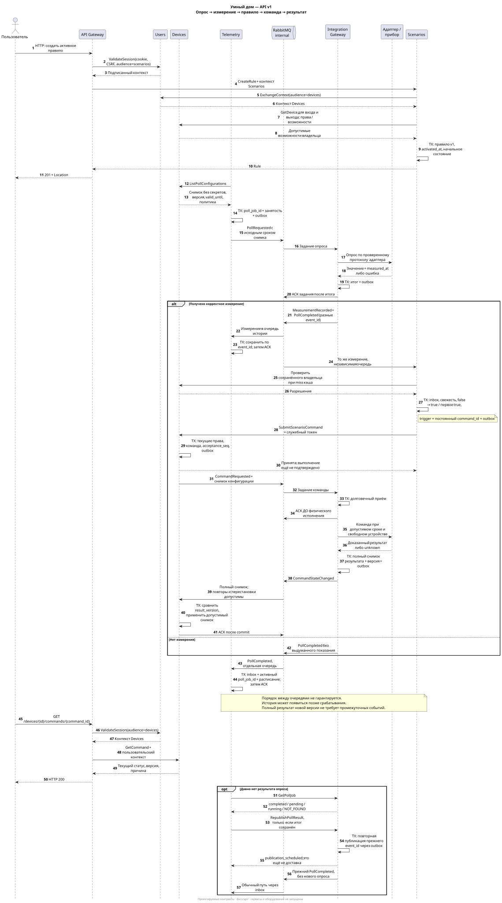

Проверки и ограничения приведены в [документации API](docs/api/README.md#проверка-и-локальный-просмотр). Runtime сервисов и оборудования — **NOT RUN**.

# Задание 5. Работа с docker и docker-compose

Перейдите в apps.

Там находится приложение-монолит для работы с датчиками температуры. В README.md описано как запустить решение.

Вам нужно:

1) сделать простое приложение temperature-api на любом удобном для вас языке программирования, которое при запросе /temperature?location= будет отдавать рандомное значение температуры.

Locations - название комнаты, sensorId - идентификатор названия комнаты

```
	// If no location is provided, use a default based on sensor ID
	if location == "" {
		switch sensorID {
		case "1":
			location = "Living Room"
		case "2":
			location = "Bedroom"
		case "3":
			location = "Kitchen"
		default:
			location = "Unknown"
		}
	}

	// If no sensor ID is provided, generate one based on location
	if sensorID == "" {
		switch location {
		case "Living Room":
			sensorID = "1"
		case "Bedroom":
			sensorID = "2"
		case "Kitchen":
			sensorID = "3"
		default:
			sensorID = "0"
		}
	}
```

2) Приложение следует упаковать в Docker и добавить в docker-compose. Порт по умолчанию должен быть 8081

3) Кроме того для smart_home приложения требуется база данных - добавьте в docker-compose файл настройки для запуска postgres с указанием скрипта инициализации ./smart_home/init.sql

Для проверки можно использовать Postman коллекцию smarthome-api.postman_collection.json и вызвать:

- Create Sensor
- Get All Sensors

Должно при каждом вызове отображаться разное значение температуры

Ревьюер будет проверять точно так же.


## Решение задания 5

Реализован [эмулятор температуры](apps/temperature-api/main.go) на Go со стандартной
библиотекой: это стек монолита, дополнительных зависимостей для одного HTTP API не
потребовалось. Поддерживаются GET `/temperature?location=…` и `/temperature/{id}`:
первый нужен по условию, второй уже используется монолитом при чтении датчиков.
Ответ совместим с `TemperatureResponse`, время — UTC RFC3339. Сопоставление комнат
и ID соответствует условию выше; эмулятор не владеет реестром датчиков монолита.

Показания генерируются в целых десятых от 150 до 300 с исключением предыдущего
значения, затем делятся на 10: диапазон 15–30 °C, шаг 0,1, без соседних повторов.
История защищена mutex, известные ID и комнаты используют общий ключ. История
сбрасывается при перезапуске процесса; порядок доставки конкурентных ответов
может отличаться от порядка генерации. `/health` не меняет показания.

[Compose](apps/docker-compose.yml) постоянно включает PostgreSQL, `temperature-api`
и монолит. Монолит ожидает healthy обеих зависимостей. Проверка БД выполняет SQL
через TCP к таблице `sensors`; ожидания принятия соединений недостаточно для
проверки завершения инициализации. Это соответствует механизму
[`service_healthy` в Compose](https://docs.docker.com/compose/how-tos/startup-order/).
Пароль передаётся монолиту отдельно через `PGPASSWORD`, без вставки в URI.
Внутренний адрес эмулятора — `http://temperature-api:8081`.

Данные БД находятся в именованном томе; SQL инициализации подключён только для
чтения. `POSTGRES_DB=postgres` позволяет исходному SQL создать `smarthome`.
Скрипт применяется только к пустому каталогу данных, изменение env-пароля не
изменяет уже созданную БД — это ограничения
[официального образа PostgreSQL](https://hub.docker.com/_/postgres).

Настройки находятся в ignored `apps/.env`; отслеживаемый
[`.env.example`](apps/.env.example) содержит учебные значения. Внешние порты
настраиваются независимо от внутренних адресов. [Скрипт запуска](apps/init.sh)
использует Compose v2 и проверяет HTTP-готовность монолита. Все URL
[Postman-коллекции](apps/smarthome-api.postman_collection.json) используют `{{baseUrl}}`.
Подготовка env, команды запуска и проверки описаны в [apps/README.md](apps/README.md).

### Фактические проверки 2026-10-22

| Статус | Проверка и граница доказательства |
| --- | --- |
| PASS | Эмулятор: `go test -race ./...`, `go vet ./...`; httptest проверяет оба маршрута, контракт, сопоставления, неизвестные значения, ошибки, диапазон/шаг, историю и конкурентные запросы |
| PASS | Монолит: `go test ./...`, `go vet ./...`; unit-тестов в модуле нет |
| PASS | `bash -n apps/init.sh`, JSON и согласованность URL коллекции, ignore-правила env, относительные ссылки и `git diff --check` |
| PASS | Из `apps`: `docker compose config --quiet` с локальным env и `docker compose --env-file .env.example config --quiet`; пустой пароль отвергается |
| PASS | Сборка обоих приложений, запуск `init.sh` из `/tmp` с `COMPOSE_PROJECT_NAME=warmhouse-task5-20261022`; PostgreSQL и эмулятор healthy, HTTP `/health` монолита 200 на порту 18080 |
| PASS | Python `urllib.request`: оба прямых маршрута эмулятора, HTTP 201 при Create Sensor, пять Get All Sensors и чтение фактического ID; проверены значения 15–30, шаг, статус и свежие временные отметки. Последовательность для ID 2: 17,3 → 20,2 → 17,4 → 22,5 → 27,7 °C |
| PASS | Созданный датчик сохранился после перезапуска PostgreSQL; остановка и запуск эмулятора восстановили выдачу показаний |
| PASS | Отдельный новый том, порты 18081/18082: пароль с символами `@:/?#`, HTTP health, создание и чтение датчика через монолит. Временный override задавал отдельные имена контейнеров и свободную подсеть из-за исчерпания стандартного пула Docker; основная конфигурация не менялась. Вспомогательный стек после проверки остановлен, данные сохранены |
| NOT RUN | Запуск запросов в интерфейсе Postman; сценарий коллекции воспроизведён через Python HTTP-клиент |

Первая попытка Go-проверок была ограничена песочницей; проверки повторены с доступом
к установленному Go и кэшу. В проверочном сценарии `docker compose start --wait`
оказался несовместим с установленной v2.29.1; заменён на поддерживаемый `up --wait`,
после чего сценарий прошёл. Чужие контейнеры не изменялись, тома не удалялись.


# **Задание 6. Разработка MVP**

Необходимо создать новые микросервисы и обеспечить их интеграции с существующим монолитом для плавного перехода к микросервисной архитектуре. 

### **Что нужно сделать**

1. Создайте новые микросервисы для управления телеметрией и устройствами (с простейшей логикой), которые будут интегрированы с существующим монолитным приложением. Каждый микросервис на своем ООП языке.
2. Обеспечьте взаимодействие между микросервисами и монолитом (при желании с помощью брокера сообщений), чтобы постепенно перенести функциональность из монолита в микросервисы. 

В результате у вас должны быть созданы Dockerfiles и docker-compose для запуска микросервисов.

### Основа MVP: этап 1 (2026-10-22)

Подготовлен [локальный демонстрационный профиль](apps/mvp-profile.md) и
[отдельный Compose-запуск](apps/README.md#локальная-основа-mvp-этап-1): существующий
монолит, PostgreSQL, RabbitMQ и единый симулятор на базе `temperature-api`.
Код и тесты эмулятора задания 5 сохранены; новые обработчики AMQP пока не реализованы.
Добавлены Node runner и [генерация Go/JVM protobuf/gRPC](apps/contracts/README.md)
из общего proto. У монолита закреплены базовые образы вместо `latest`.

- PASS: Compose config, сборка монолита/симулятора/runner/codegen, readiness четырёх процессов на новом изолированном проекте.
- PASS: реальный HTTP Create → пять List → Get by ID; оба маршрута симулятора, меняющиеся значения и свежие времена; AMQP-соединение runner и Ajv date-time (3 теста).
- PASS: существующие тесты симулятора с `-race`, Go vet обоих модулей; в монолите unit-тестов нет.
- PASS: Go/JVM генерация и компиляция; повторная генерация дала одинаковые SHA256 для 83 файлов. Предметных gRPC-тестов пока нет (`NO-SOURCE` JVM).
- PASS: существующие проверки API (127 schema examples), protoc descriptor, сборка просмотра и diff; это не runtime новых сервисов.
- NOT RUN: этапы 2–4 — Devices, Telemetry, новые HTTP/AMQP-потоки и общая приёмка. Задание 6 целиком не завершено; риск требования ООП-языков при выбранном Go сохраняется.
