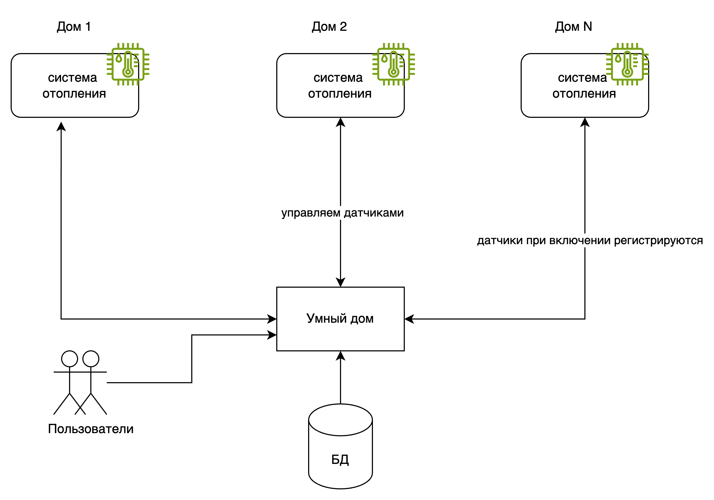

# Исходные условия проекта

Источник: описание компании и условия проекта, переданные пользователем 2026-10-19. Ниже сохранён исходный текст с оформлением в Markdown. Описание текущей системы относится к условию задания; оно не является подтверждением полноты реализации в учебном репозитории. Решения по заданиям оформляются в [Project_template](../README.md).

## 1. Текущее решение

Нынешнее приложение компании позволяет только управлять отоплением в доме и проверять температуру.

Каждая установка сопровождается выездом специалиста по подключению системы отопления в доме к текущей версии системы.

Архитектура приложения представляет из себя монолит на Go с СУБД Postgres. Всё синхронно. Никаких асинхронных вызовов, микросервисов и реактивного взаимодействия в системе нет. Всё управление идёт от сервера к датчику. Данные о температуре также получаются через запрос от сервера к датчику.

Самостоятельно подключить свой датчик к системе пользователь не может.

## 2. Целевая экосистема, которую необходимо создать

Экосистема доступна пользователю в режиме самообслуживания по модели SaaS.

Позволяет управлять отоплением, включать и выключать свет, запирать и отпирать автоматические ворота, удалённо наблюдать за домом, возможно и будущее неуточнённое поведение.

Пользователь самостоятельно выбирает необходимые ему модули умного дома (устройства), сам их подключает, настраивает сценарии работы и просматривает телеметрию.

Компания не занимается производством устройств, но поддерживает подключение к экосистеме устройств партнеров по стандартным протоколам.

### Требования к экосистеме

- Модули управления приборами и сами приборы (устройства) должны быть максимально готовы к использованию и продаваться в отдельных комплектах для удобной покупки и подключения.
- Устройства должны быть доступны через интернет (для удалённого наблюдения и доступа). Предполагается, что пользователь будет иметь интернет-канал, к которому их можно подключить.
- Покупатели могут программировать систему для управления различными модулями в соответствии со своими потребностями.

## 3. Лэндскейп компании

Над проектом работают:

- Команда разработчиков. В ней пять человек. Они будут работать над рефакторингом и разделением монолита на микросервисы.
- Команда QA. В ней три человека. Они будут проводить тестирование новой системы.
- Команда по обслуживанию клиентов. Эту команду из десяти человек обучат работе с новой системой, чтобы они смогли предоставлять поддержку пользователям.
- Команда по продажам и маркетингу. Их пять человек. Они будут заниматься продвижением новых модульных комплектов.

Сейчас развёрнуто монолитное приложение на Go с PostgreSQL в качестве СУБД. У приложения 100 веб-клиентов, к системе подключены 100 модулей управления отоплением.

## 4. Цели бизнеса

Описана As-Is и To-Be архитектура решения. Создан план по переходу к целевой системе.

Разработан MVP с разделёнными микросервисами для управления отоплением, освещением, наблюдением, воротами. Продуман вариант подключения еще неизвестных датчиков.

## Приложение. Схема из условия

Изображение предоставлено пользователем и сохранено рядом с описанием исходных условий: [img.png](img.png). На схеме показаны системы отопления, приложение «Умный дом» и БД, а также подписи об управлении датчиками и их регистрации при включении. Это исходный материал для анализа; диаграмма C4 по заданию 1 оформляется отдельно.

