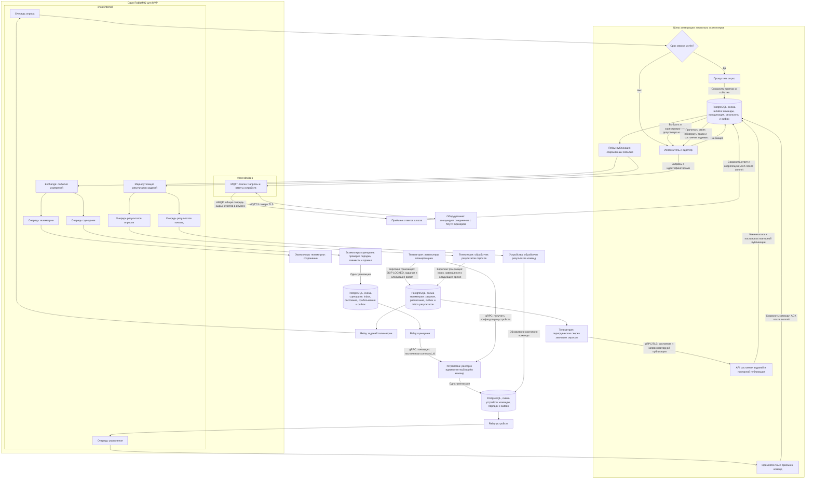

# Наработки по доменам целевой системы

Статус на 2026-10-21: согласованы пять предметных сервисов, включая отдельно масштабируемое видеонаблюдение, отдельные модели данных и фоновый Pull-опрос. Видеопоток передаётся по медиаканалу без очередей сообщений. Выбран отдельный масштабируемый шлюз с общими адаптерами, исполняющий задания телеметрии и устройств. Для него согласованы отдельные очереди опроса и управления и пропуск просроченных опросов. Для результатов измерений выбраны независимые подписки телеметрии и сценариев, для публикации результатов шлюза — Transactional Outbox. Согласованы inbox/outbox сценариев, идемпотентный приём команд с outbox устройств и пороговые триггеры по переходу условия. Для внутренней доставки выбран RabbitMQ; для MVP выбрана одна общая БД PostgreSQL с отдельными схемами сервисов. Для MVP выбран общий RabbitMQ с MQTT-плагином и двумя vhost, с возможностью последующего разделения. Конфигурация ресурсов остаётся предметом реализации. Диаграммы Containers, Components и критичные sequence оформлены в разделе задания 2 корневого README. Это описание проектирования, а не реализованных сервисов. Анализ As-Is находится в [задании 1](../README.md#задание-1-анализ-и-планирование).

Для целевой экосистемы выбраны пять предметных областей внутри общего домена умного дома:

| Область | Назначение и основание в условии |
| --- | --- |
| Устройства умного дома | Подключение, принадлежность и управление возможностями оборудования, включая регистрацию камер. Условие требует самостоятельного подключения и поддержки устройств партнёров |
| Телеметрия | Получение и предоставление показаний и состояний устройств. Условие прямо предусматривает просмотр телеметрии пользователем |
| Пользователи | Работа с пользователями экосистемы самообслуживания. Выделение этой области — архитектурное решение на основании модели SaaS и пользовательских действий; конкретные требования к учётным записям, ролям и совместному доступу в условии не описаны |
| Сценарии автоматизации | Настройка и выполнение пользовательских правил работы устройств. Основание прямо указано в условии: пользователь «настраивает сценарии работы», а покупатели могут программировать управление модулями под свои потребности |
| Видеонаблюдение | Организация удалённого просмотра видео. Выделено отдельно для независимого масштабирования медианагрузки |

Разделение по областям ответственности позволяет отдельно рассматривать работу устройств, телеметрию, пользователей, правила автоматизации и видео. Рассматривались также группировка функций вокруг личного кабинета и разделение по типам оборудования. Личный кабинет объединяет пользовательские действия из разных областей. Для отопления, освещения и ворот сохраняется общая область устройств; видеонаблюдение выделено из-за отдельного профиля нагрузки.

Телеметрия выделена в самостоятельную область на одном уровне с устройствами. Она отвечает за показания и состояния, тогда как область устройств — за подключение и управление оборудованием. Это позволяет отдельно развивать обработку измерений и управление устройствами, сохраняя связь каждого измерения с его источником. Рассмотрена альтернатива размещения телеметрии как поддомена устройств; выбран вариант с отдельной областью. Следствие — между областями потребуется согласовать идентификацию устройств и обмен данными.

Интеграции с устройствами партнёров выделены как поддомен области устройств. Их ответственность — поддержка протоколов оборудования и преобразование команд и показаний между форматом системы и форматом конкретного устройства. Основание — интеграции обеспечивают взаимодействие с оборудованием, а пользовательские правила автоматизации относятся к отдельной области сценариев. Рассмотренный вариант самостоятельной области интеграций заменён вложенной группировкой внутри устройств.

Текущая карта областей:

```text
Умный дом
├── Устройства умного дома
│   └── Интеграции с устройствами партнёров
├── Телеметрия
├── Пользователи
├── Сценарии автоматизации
└── Видеонаблюдение
```

**Согласованная граница устройств и пользователей:** связь устройства с пользователем принадлежит контексту устройств. Контекст пользователей отвечает за идентификацию пользователя; контекст устройств хранит ссылку на его идентификатор и управляет принадлежностью устройства. Альтернатива — ведение списка принадлежащих пользователю устройств в контексте пользователей. Выбран первый вариант, чтобы подключение и принадлежность устройства управлялись в одном контексте. Для MVP выбран один владелец без совместного доступа; конкретный способ входа пока не определён.

**Границы контекстов:**

| Контекст | Собственные данные и решения |
| --- | --- |
| Устройства | Реестр подключённого оборудования, принадлежность пользователю, поддерживаемые команды и их отправка через интеграции |
| Телеметрия | Полученные показания и состояния устройств, время измерений и предоставление этих данных потребителям |
| Пользователи | Учётные записи и идентификация пользователей |
| Сценарии автоматизации | Условия и действия пользовательских правил, включённость сценария и решение о запуске команды по полученным показаниям |
| Видеонаблюдение | Организация просмотра и сеансы видео; принадлежность камеры остаётся в контексте устройств |

Например, в сценарии «при температуре ниже 18 °C включить отопление» шлюз получает показание и публикует событие измерения. Телеметрия сохраняет его, а сервис сценариев независимо проверяет условие и запрашивает включение отопления у контекста устройств. Тот проверяет команду и ставит задание шлюзу. Отправка команды не доказывает изменение состояния прибора: сообщённое прибором состояние поступает отдельным результатом измерения.

Контексты взаимодействуют через идентификаторы пользователей и устройств, измерения и запросы команд. Владение данными и правилами остаётся у соответствующего контекста: интеграции не принимают решения о срабатывании пользовательских сценариев, а сценарии не реализуют протоколы оборудования.

## Декомпозиция на микросервисы (задание 2)

**Решение:** пять предметных сервисов — устройства, телеметрия, пользователи, сценарии и видеонаблюдение — и отдельно масштабируемый шлюз интеграций. Итого шесть логических сервисов; фактическое число контейнеров зависит от реализации медиакомпонентов и инфраструктуры. Первоначальная декомпозиция на четыре предметных сервиса расширена видеонаблюдением по решению пользователя для изоляции и независимого масштабирования медианагрузки. Отдельные сервисы отопления, освещения и ворот не выделяются.

| Область As-Is | Размещение в To-Be |
| --- | --- |
| Управление устройствами | Сервис устройств; развитие учёта оборудования до самостоятельного подключения и поддержки устройств партнёров |
| Управление отоплением | Сервис устройств; отопление становится одной из поддерживаемых возможностей оборудования наряду с освещением и воротами |
| Мониторинг температуры | Сервис телеметрии; расширение до измерений и сообщённых состояний разных типов устройств |
| В As-Is не выделено | Сервис пользователей для учётных записей и идентификации в экосистеме самообслуживания |
| В As-Is не выделено | Сервис сценариев для пользовательских условий и действий |
| В As-Is не выделено | Сервис видеонаблюдения для удалённого просмотра с отдельным масштабированием |

**Основания выбора:** в команде пять разработчиков; общая модель устройств сокращает число отдельных сервисов для направлений управления. Видео выделено отдельно из-за ожидаемой нагрузки и необходимости масштабировать его независимо от опроса и команд. Потребность в ресурсах пока не измерена. Общая модель идентификации, принадлежности и возможностей оборудования сохраняется, различия протоколов учитываются адаптерами. Она не означает автоматическую поддержку нового оборудования: для нового протокола либо возможности потребуется расширение.

**Рассмотренная альтернатива:** первоначально обсуждались восемь предметных сервисов — четыре базовых плюс отдельные отопление, освещение, ворота и наблюдение. Полное разделение по типам оборудования не принято из-за числа сетевых границ и эксплуатационной работы. Позже отдельно выбран сервис видео; аналогичная необходимость для отопления, освещения и ворот пока не установлена.

**Соответствие условию:** формулировка бизнес-цели «с разделёнными микросервисами для управления отоплением, освещением, наблюдением, воротами» трактуется в выбранной архитектуре как микросервисная экосистема, обеспечивающая все перечисленные возможности, без обязательного соответствия «одно направление — один сервис». Это явная интерпретация условия, а не изменение исходного текста. Разделение устройств и телеметрии также соответствует требованию задания 6 создать эти сервисы.

**Последствия и открытые решения:** общий шлюз позволяет отдельно выпускать и масштабировать адаптеры, но добавляет общую зависимость доступа к оборудованию. Сервис видео добавляет отдельное развёртывание и эксплуатацию медиасеансов; для MVP выбран просмотр в реальном времени без записи по WebRTC с прямым медиаканалом между камерой и клиентом пользователя и резервной ретрансляцией через TURN. Детали межсервисных контрактов, конфигурация общей БД остаётся предметом реализации; состав компонентов показан на диаграммах C4; детальные контракты API оформляются в задании 4.

### Модели данных и владение

**Решение:** каждый сервис имеет отдельную модель данных и управляет её хранением и изменением. Другие сервисы не читают и не изменяют его таблицы напрямую. Обмен нужными сведениями происходит через межсервисные контракты. Для шлюза выбраны очереди заданий, для измерений — независимые подписки телеметрии и сценариев.

| Сервис | Его модель данных | Связь с другими контекстами |
| --- | --- | --- |
| Устройства | Реестр, принадлежность, возможности и параметры подключения; попытки привязки; команды, порядок принятия, outbox и последняя применённая версия результата | Ссылка на идентификатор пользователя; учётная запись принадлежит сервису пользователей |
| Телеметрия | Измерения и сообщённые состояния, время измерения, идентификатор источника, расписание и задания опросов, outbox заданий и inbox результатов | Ссылка на идентификатор устройства; параметры подключения и реестр принадлежат сервису устройств |
| Пользователи | Учётные записи, данные идентификации и серверные сессии с состоянием отзыва | Идентификатор пользователя предоставляется другим сервисам; список принадлежащих ему устройств хранится в сервисе устройств |
| Сценарии | Условия, действия, версии и состояние правил, inbox, срабатывания и outbox команд | Ссылки на пользователя и устройства; измерения получает через собственную подписку на события шлюза, выполнение команд запрашивает у устройств |
| Видеонаблюдение | Модель сеансов просмотра и параметры их организации; точный состав хранения ещё не выбран | Ссылки на пользователя и камеру; реестр и принадлежность камеры остаются в устройствах, проверка доступа через общий положительный кэш и gRPC к устройствам |
| Шлюз интеграций | Ожидающие команды, координация устройства, права исполнения, коррелированные сырые ответы, результаты и outbox | Идентификаторы устройств и команд; собственные данные выполнения отделены от реестра и истории телеметрии |

Идентификаторы связывают модели логически, без внешних ключей и SQL JOIN между хранилищами разных сервисов. Например, измерение содержит `device_id`, но телеметрия не читает таблицу устройств для получения его владельца. Способ получения этих сведений и проверки доступа нужно определить в контракте взаимодействия.

**Альтернатива и основания:** общие таблицы и прямые запросы к ним упрощают объединение данных, но связывают сервисы со схемой хранения друг друга. Выбраны отдельные модели, чтобы каждый сервис мог изменять внутреннюю структуру данных, сохраняя совместимость своего контракта.

**Размещение MVP:** одна общая база данных PostgreSQL на общем экземпляре СУБД. Данные сервисов логически разделены схемами и отдельными ролями доступа; сервис работает только со своей схемой и управляет её миграциями. Это уточняет ранее выбранное отдельное владение моделями, а не разрешает общие таблицы. Схема шлюза содержит его результаты и outbox. Необходимость постоянного хранения сеансов видео ещё не установлена; видеоархива в БД нет.

**Выбор СУБД:** PostgreSQL сохраняет технологию текущего монолита и поддерживает выбранные схемы, права доступа и транзакционное сохранение состояния с inbox/outbox. Отдельное специализированное хранилище телеметрии для MVP не добавляется: оно увеличило бы число технологий для небольшой команды, а необходимость пока не подтверждена нагрузкой. Частота опроса и сроки хранения измерений ещё не заданы. Например, 100 устройств при одном измерении в секунду дают 8,64 млн измерений в сутки; это условный расчёт, а не утверждённая нагрузка или результат тестирования PostgreSQL. Производительность необходимо проверить на целевых объёмах и запросах.

**Основания и альтернатива:** отдельные экземпляры для сервисов обсуждались ради изоляции нагрузки и отказов, но пользователь выбрал общую БД с учётом небольшой команды. Общий экземпляр упрощает развёртывание, резервное копирование и сопровождение. Цена решения — конкуренция за ресурсы, в том числе между телеметрией и обработкой команд, и общая зависимость от доступности БД. Отдельные схемы и роли не изолируют нагрузку и отказ самого экземпляра.

**Границы:** запрет межсервисных SQL JOIN, внешних ключей и прямого доступа к чужим таблицам сохраняется даже внутри общей БД. Inbox, результат обработки и outbox одного сервиса сохраняются его локальной транзакцией; распределённый процесс не превращается в общую транзакцию нескольких сервисов. При необходимости дальнейшего разделения данные отдельного сервиса можно переносить вместе с его схемой, но такой перенос потребует самостоятельной миграции.

**Открытая реализация:** версия PostgreSQL, права ролей, ограничения соединений и нагрузки, сроки хранения телеметрии, резервное копирование и восстановление. Размещение одной БД не определяет автоматически наличие реплик или высокой доступности. Проверку существования устройства и реакцию на удаление или смену владельца нужно определить в межсервисных контрактах.

### Видеонаблюдение

**Принятое решение:** видеонаблюдение — отдельный независимо масштабируемый микросервис. Видеопоток передаётся по медиаканалу и не помещается в очереди опроса, команд или событий измерений. Для нового сервиса собственные очереди заданий на данном этапе не вводятся; сигнализация через шлюз отделена от очередей опросов и команд управления.

**Объём MVP:** только просмотр в реальном времени, без записи и видеоархива. Хранилище видеозаписей, воспроизведение прошлого видео и управление сроками хранения записей в MVP не проектируются. Техническая буферизация потока не является архивом; собственная модель сеансов сервиса сохраняется.

**Основания и последствия:** исходное требование удалённого наблюдения покрывается просмотром в реальном времени. Отказ от записи сокращает объём разработки и исключает затраты платформы на видеоархив, но пользователь не сможет просмотреть пропущенный момент. Архив возможен как отдельное будущее расширение, его реализация сейчас не согласована.

**Маршрут MVP:** выбран WebRTC с предпочтительным прямым медиаканалом «камера → браузер пользователя» и резервным маршрутом «камера → TURN → браузер», если прямой путь недоступен. Сервис видео организует сеанс, проверку права просмотра и обмен параметрами соединения; медиапоток не проходит через сервис видео, общий шлюз интеграций или брокер. Защищённый канал устройства к платформе для команд и показаний сохраняется и не является самим медиаканалом. Решение о WebRTC и TURN принято 2026-10-21.

**Границы:** сервис устройств продолжает регистрировать камеры и хранить их принадлежность. Сервис видео управляет сеансами просмотра; его модель данных отделена от реестра устройств. Проверка доступа использует выбранный общий положительный кэш и gRPC к устройствам при отсутствии разрешения или недоступности кэша. Video управляет авторизованным сеансом; адаптация и доставка сигнализации камере принадлежат шлюзу интеграций. Точный транспорт определяется существующим протоколом совместимой модели, как описано ниже. Поток не должен становиться публичным по одному идентификатору камеры.

**Основания и компромиссы:** прямой канал сокращает серверный медиатрафик по сравнению с обязательной передачей через медиасервер. Нагрузка сервиса видео в выбранном варианте определяется главным образом организацией и числом сеансов; её нельзя оценивать как суммарный битрейт камер. Отдельное масштабирование сервиса сохраняется. Камера и клиент должны поддерживать совместимый формат потока; серверное перекодирование в прямом пути не выполняется. При нескольких зрителях ограничения исходящего канала и числа сеансов камеры могут стать узким местом. Очереди сообщений для видеопотока не используются; небольшие технические буферы медиапротокола допустимы.

**Сетевая граница:** наличие исходящего соединения камеры с платформой не гарантирует прямую связь с клиентом пользователя. Выбран механизм ICE с STUN для определения вариантов связи и TURN для резервной ретрансляции. STUN не переносит медиапоток. TURN повышает доступность при NAT и сетевых ограничениях, но не гарантирует просмотр в любой сети. Обмен параметрами сеанса (signaling) проектируется отдельно от медиапотока; выбор WebRTC не назначает ему автоматически транспорт. Основания: [соединения WebRTC](https://webrtc.org/getting-started/peer-connections), [TURN](https://webrtc.org/getting-started/turn-server).

**Инфраструктура и нагрузка:** TURN добавляется как отдельный инфраструктурный контейнер, независимо масштабируемый от сервиса видео. Это не седьмой предметный микросервис. Его нагрузка определяется ретранслируемыми потоками и сетевой пропускной способностью, тогда как сервис видео обслуживает организацию сеансов. Приняты дополнительные расходы на медиатрафик и эксплуатацию. Ретрансляция не добавляет запись, архив или очереди для видеопотока. Конкретный продукт, собственное или управляемое размещение, конфигурация STUN/TURN и лимиты ещё не выбраны.

**Совместимость и альтернатива:** MVP ограничивается камерами с подходящей поддержкой WebRTC, совместимого кодека и доступного платформе механизма организации сеанса. TURN не преобразует произвольный поток камеры в WebRTC и не заменяет медиашлюз. Совместимость конкретных партнёрских моделей пока не проверена; изменение их прошивки под платформу не предполагается. Вариант только прямой связи проще и дешевле по серверному трафику, но оставляет часть сетей без просмотра; пользователь выбрал резервный TURN ради большей доступности удалённого наблюдения.

**Открытые решения:** конкретные сообщения и транспорт сигнализации выбранной камеры, проверка совместимости камер/кодеков/клиентов, выдача доступа к медиасеансу и TURN, отзыв доступа к активному сеансу. Нагрузка и требуемое число экземпляров сервиса и TURN пока не измерены. WebRTC и резервная ретрансляция выбраны архитектурно; реализации и сетевых проверок нет.

### Подключение устройств к платформе

**Принятое решение для MVP:** совместимое партнёрское устройство само устанавливает и поддерживает защищённое исходящее соединение с платформой. Облачный шлюз использует этот канал для запросов показаний и команд; устройство возвращает ответы. Пользователю не требуется публиковать входящий порт прибора. Домашний хаб и облако производителя не входят в выбранный путь подключения MVP.

**Сохранение Pull:** устройство инициирует сетевое соединение, а платформа — прикладной запрос измерения. Поэтому исходящий канал устройства не меняет выбранную Pull-модель на Push. Интервалы опроса по-прежнему определяет планировщик телеметрии, задания исполняет шлюз. Передача видео этим решением не определена.

**Допущение о совместимости:** MVP поддерживает ограниченный каталог готовых комплектов партнёров. Платформа адаптируется к их существующим протоколам; доработка прошивки под наш контракт не предполагается. Возможность прямого подключения к платформе, аутентификация, запрос показаний и достоверный `measured_at` требуют проверки для каждого комплекта. Это условия совместимости выбранного пути MVP, а не подтверждённые свойства произвольных приборов. Адаптер преобразует существующие сообщения партнёра во внутреннюю модель. Неподдерживаемые возможности нельзя получить одним преобразованием формата: для такого устройства потребуется другой путь интеграции либо исключение из каталога MVP.

**Альтернативы и основания:** прямой входящий доступ к прибору потребовал бы настройки доступности домашней сети; для самообслуживания основным вариантом не выбран. Домашний хаб расширяет поддержку локальных протоколов, но добавляет оборудование и его сопровождение. Облако производителя позволяет использовать его готовую интеграцию, но добавляет внешнюю зависимость, ограничения API и возможную задержку показаний. Выбран исходящий канал устройства с ограниченным каталогом совместимых комплектов: он не требует домашнего хаба, но доступен только при поддержке такого подключения готовым устройством.

**Последствия и риски:** при выбранном MQTT соединения устройств обслуживает MQTT-брокер; шлюз адресует запросы через подписки, а не через собственную карту сокетов. Ответ может обработать другой экземпляр шлюза, поэтому корреляция по идентификатору запроса и состояние операции должны быть доступны ему. Последовательность команд одному прибору и защита от повторного действия не обеспечиваются одним выбором MQTT. Необходимо предусмотреть восстановление соединений и ограничение массовых переподключений. Потеря интернета делает облачный опрос и управление недоступными; автономное исполнение сценариев на устройстве этим решением не добавляется.

**Протокол MVP:** MQTT 5 поверх TLS. Прибор устанавливает исходящее соединение с MQTT-брокером платформы, подписывается на адресованные ему запросы и публикует ответы. Шлюз инициирует опрос, связывает ответ с запросом, проверяет и нормализует данные, сохраняет результат с outbox и затем публикует внутреннее событие. Необработанные ответы прибора не направляются непосредственно подписчикам телеметрии и сценариев.

**Основания и альтернатива:** выбран стандартный MQTT вместо собственного протокола доставки поверх WebSocket. Используется существующая поддержка протокола устройством; добавление MQTT-библиотеки партнёром по нашему требованию не предполагается. MQTT определяет подписки и механизмы доставки, но не значения команд, структуру измерений, ошибок или процедуру привязки: адаптер реализует соответствие прикладному протоколу конкретного партнёра. Поддержка MQTT сама по себе не означает совместимость оборудования с выбранным путём MVP. Видео остаётся отдельным медиапотоком.

**Границы надёжности и доступа:** MQTT-подтверждение не является подтверждением физического выполнения. Стабильные `request_id`, `command_id`, учёт состояния и защита от повторов сохраняются. Настройки сеанса и сроки жизни сообщений должны исключать исполнение неактуальных заданий после восстановления связи; проверка актуальности команды требуется перед физическим действием. Устройство получает права только на свои каналы запросов и ответов; идентификатор в названии topic не заменяет проверку полномочий. Внешний MQTT-доступ не даёт доступа к внутренним очередям микросервисов.

**Размещение MQTT:** для MVP выбран MQTT-плагин общего RabbitMQ с отдельным vhost `devices`; внутренние задания и события находятся в vhost `internal`. Шлюз работает с обеими областями, сохраняя проверку и нормализацию на их границе. План развития размещения приведён в разделе о брокере.

**Открытые решения:** механизм аутентификации, настройки QoS и сеансов, сроки сообщений, правила retained-сообщений, схема topic и ACL, восстановление связи и детали выбранного AMQP-потребления сырых ответов шлюзом. Общий экземпляр упрощает сопровождение, но сохраняет конкуренцию за ресурсы и общую область отказа.

Основа протокола — [MQTT 5.0, OASIS](https://docs.oasis-open.org/mqtt/mqtt/v5.0/os/mqtt-v5.0-os.html); возможности выбранного плагина описаны в [документации RabbitMQ MQTT](https://www.rabbitmq.com/docs/mqtt).

**Самостоятельная привязка:** владение устройством хранится в сервисе устройств, учётная запись пользователя — в сервисе пользователей. Выбраны секрет из комплекта и обязательное подтверждение кнопкой на приборе; процедура описана ниже.

### Владение и доступ в MVP

**Принятое решение:** один владелец дома и его подключённых устройств. Совместный доступ, приглашения членов семьи и роли участников в MVP не входят: исходные условия требуют самостоятельного подключения и управления пользователем, но не требуют разделять доступ. Это ограничение объёма MVP, выбранное пользователем, а не прямой запрет в исходном задании.

Принадлежность устройства хранится сервисом устройств. До завершения привязки устройство может не иметь владельца; после неё допускается один владелец. Пользовательские операции управления, чтение телеметрии и просмотр видео разрешаются владельцу соответствующего устройства. Пользователь управляет собственными сценариями; сценарий может читать показания и отправлять команды только для принадлежащих ему устройств. Автоматическое исполнение не должно обходить ограничение владения.

По сравнению с совместным доступом выбранная модель исключает необходимость приглашений и матрицы прав участников. Между аккаунтами сохраняется изоляция данных: идентификатор устройства в запросе сам по себе не даёт права доступа. После входа пользователь подтверждается серверной сессией; для передачи контекста выбран подписанный внутренний токен. Способ первоначального входа ещё предстоит согласовать; проверка принадлежности использует общий положительный кэш и gRPC к устройствам. Правила смены владельца описаны отдельно в разделе привязки; второй одновременный владелец не допускается.

### Привязка устройства к владельцу

**Принятое решение для MVP:** пользователь предъявляет секрет первоначальной привязки из комплекта, сканируя QR-код или вводя код вручную, и подтверждает конкретную попытку кнопкой на устройстве. Приоритет физического подтверждения означает, что одного кода недостаточно. Сам прибор подтверждает попытку через собственный аутентифицированный канал.

Порядок привязки:

1. Пользователь входит в аккаунт и предъявляет код в интерфейсе добавления устройства.
2. Сервис устройств проверяет секрет и отсутствие владельца, создаёт ограниченную по времени попытку, связанную с пользователем и прибором. Для прибора допускается одна активная попытка.
3. Пользователь нажимает кнопку подтверждения. Прибор передаёт через шлюз подтверждение с идентификатором текущей попытки; произвольное нажатие не подтверждает любую ожидающую заявку.
4. Сервис устройств атомарно проверяет актуальность попытки и отсутствие владельца, сохраняет привязку и отмечает секрет первоначальной привязки использованным. Конкурирующая попытка не может назначить второго владельца. Повтор завершённого запроса возвращает прежний результат.

**Граница ответственности:** сервис устройств владеет попытками, их сроками и привязкой; шлюз обеспечивает связь с аутентифицированным прибором; сервис пользователей подтверждает личность пользователя. Секрет привязки и постоянные учётные данные прибора имеют разные назначения. Закрытый ключ прибора не передаётся в QR-коде; конкретный способ выдачи и проверки ключей или сертификатов ещё не выбран.

**Основания и альтернативы:** только секрет из комплекта упрощает подключение, но допускает попытку присвоения по скопированному коду. Локальное сопряжение через мобильное приложение позволяет совместить настройку сети и привязку, но добавляет приложение и поддержку локального обмена. Выбраны код и кнопка: для привязки достаточно веб-интерфейса с ручным вводом кода, а совместимое устройство уже должно поддерживать подтверждение конкретной попытки. Доработка партнёрской прошивки под платформу не предполагается.

**Условия и ограничения:** прибор предварительно подключается к домашнему интернету предусмотренным партнёром способом. Выбранная процедура привязки сама по себе не настраивает Wi-Fi. Требуются ограничения частоты попыток и времени ожидания, чтобы чужие заявки не блокировали подключение надолго; конкретные значения ещё не заданы. Необходимо определить согласование состояния при потере соединения во время процедуры.

**Смена владельца:** локальный сброс не снимает облачную привязку автоматически. Передача предполагает разрешённую текущим владельцем отвязку и новое сопряжение; потеря доступа к аккаунту требует отдельной процедуры восстановления через поддержку. Детали выдачи нового секрета, отзыва прежнего доступа и обработки незавершённых команд при передаче ещё не спроектированы.

### Получение показаний от устройств

**Решение:** сохранить Pull-модель для измерений и сообщённых состояний: платформа инициирует запрос к устройству и получает ответ по защищённому каналу, установленному устройством. В текущем рабочем варианте протокольное взаимодействие выполняет отдельный шлюз, а измерения относятся к модели телеметрии. Результаты публикуются через outbox шлюза в независимые подписки. Решение не задаёт способ передачи видео для наблюдения.

**Контекст и основания:** в As-Is сервер сам опрашивает датчики. В To-Be условие не предписывает Push или Pull; сохранение Pull выбрано для преемственности с текущим способом работы оборудования. Масштабирование само по себе не требует ни сохранения Pull, ни перехода на Push. Для MVP выбран исходящий канал совместимого партнёрского устройства к платформе, описанный выше.

**Рассмотренные альтернативы:** Push, при котором оборудование самостоятельно отправляет измерения, и смешанная модель в зависимости от возможностей устройства. На начальном этапе выбран Pull; поддержка устройств, работающих только через Push, этим решением не обеспечивается.

**Последствия для проектирования:** при росте числа устройств необходимо ограничивать параллелизм опроса, задавать интервалы и таймауты, а при нескольких исполнителях распределять работу, чтобы каждый экземпляр не опрашивал весь реестр одновременно. Для распределения создания заданий выбрано общее расписание в схеме телеметрии PostgreSQL с короткими блокировками и outbox. Координация физического выполнения остаётся отдельной задачей. Pull на границе оборудования не определяет выбор запросов или событий между микросервисами.

**Организация опроса:** выбран фоновый опрос по расписанию независимо от пользовательских запросов. Основание — приоритет автоматических сценариев: получение измерений не должно зависеть от открытия экрана пользователем. Просмотр телеметрии читает уже полученные измерения с временем измерения и получения, без синхронного опроса оборудования в рамках запроса экрана. В текущем рабочем варианте телеметрия получает конфигурации через API устройств и ведёт общее расписание в собственной схеме PostgreSQL. Планировщики атомарно сохраняют задания в outbox и обновляют расписание, relay отправляет их в RabbitMQ, шлюз выполняет опрос через адаптеры. Обновление полного списка раз в секунду обсуждалось как пример, а не утверждённый интервал или SLA. Допустимый возраст конфигурации и способ её передачи шлюзу ещё не выбраны.

Альтернатива — опрашивать устройства при просмотре данных. Она связывает получение измерений с активностью пользователей и сама по себе не обеспечивает автоматизацию при закрытом интерфейсе, поэтому не выбрана. Последствие фонового опроса — задержка обнаружения изменения зависит от интервала опроса, времени ответа оборудования и внутренней доставки данных. Конкретные интервалы и допустимый возраст измерения ещё предстоит определить. Без свежих данных новые действия по условию не создаются; последнее состояние сохраняется. Устаревшие измерения не используются для новых действий по текущему состоянию; политика описана ниже. Фоновый опрос не гарантирует актуальность данных при недоступном устройстве.

### Распределение планирования опросов

**Принятое решение для MVP:** расписание хранится в схеме телеметрии общей PostgreSQL. Несколько экземпляров планировщика распределяют записи расписания через короткие транзакции с `FOR UPDATE SKIP LOCKED`. Наступившее время опроса означает необходимость создать задание; сам физический запрос выполняет шлюз через RabbitMQ.

Запись расписания содержит ссылку на устройство, интервал и время следующего опроса. Реестр и конфигурации устройств по-прежнему получаются через gRPC сервиса устройств; прямого доступа к его таблицам нет. Память экземпляра может содержать восстанавливаемый кэш, но согласование планирования опирается на общее расписание в схеме телеметрии.

В одной транзакции планировщик:

1. Выбирает ограниченную порцию записей, для которых наступило время опроса, блокируя их и пропуская уже занятые другим экземпляром.
2. Создаёт задания с устойчивыми идентификаторами в собственном outbox.
3. Обновляет время следующего опроса выбранных записей.
4. Фиксирует изменения вместе.

Отдельный relay публикует задания из outbox в существующую очередь опросов RabbitMQ. Обращения к брокеру, сервису устройств и оборудованию не выполняются под блокировками транзакции планирования. Повторная публикация использует прежний идентификатор задания; его обработка шлюзом должна учитывать сохранённое состояние выполнения. Применение `SKIP LOCKED` к распределению работы описано в [документации PostgreSQL](https://www.postgresql.org/docs/current/sql-select.html#SQL-FOR-UPDATE-SHARE).

**Сбои:** до commit создание задания и перенос времени откатываются вместе; после завершения неуспешной транзакции запись доступна другому планировщику. После commit задание остаётся в outbox независимо от завершения процесса. Недоступность PostgreSQL останавливает новое планирование, а задержка публикации может сделать задание просроченным. Прежнее правило шлюза — не выполнять просроченные задания опроса — сохраняется.

**Основания и альтернативы:** один активный планировщик проще, но не распараллеливает планирование и требует отдельного механизма переключения для автоматического восстановления. Закрепление групп устройств за экземплярами требует перераспределения при изменении их числа и сбоях. Выбран вариант с уже принятой PostgreSQL, без нового инфраструктурного компонента. Цена — дополнительные записи расписания/outbox, нагрузка на общую БД и конкуренция за её ресурсы; производительность пока не измерена.

**Twelve-Factor и границы:** долговечное расписание находится вне процессов; заменяемые экземпляры получают работу без привязки устройств к IP или памяти планировщика. Это не гарантия однократного физического опроса при повторной доставке. Для разных опросов одного прибора выбран запрет параллельного выполнения и накопления, описанный ниже. Остаётся определить точный расчёт следующего времени после задержки, синхронизацию изменений реестра, размер порций, индексы, ограничения роста outbox и координацию его relay. Конкретные интервалы и сроки актуальности ранее не задавались и этим решением не устанавливаются.

### Опрос без накопления и параллельных запросов

**Принятое решение:** на стороне платформы для одного устройства допускается не более одного незавершённого логического задания опроса, включая ожидание в outbox или очереди, исполнение шлюзом и ожидание результата. Новые интервалы во время незавершённого опроса пропускаются: задания «на потом» не создаются. После завершения или восстановления после простоя пропущенные интервалы не воспроизводятся серией запросов; планирование продолжается для актуального состояния. Разные устройства могут опрашиваться параллельно. После локального таймаута допускается новый опрос с паузой, без гарантии завершения старой обработки внутри прибора.

**Требования к реализации:** при создании задания планировщик в той же транзакции фиксирует его идентификатор как незавершённый для устройства. Несколько записей расписания или экземпляров планировщика не должны обходить это ограничение. Долговечный признак хранится в схеме телеметрии, а не в памяти процесса; SQL-блокировки на время физического опроса не удерживаются. Шлюз также должен исключать одновременное исполнение повторных доставок одного задания несколькими экземплярами.

Учёт завершения сверяет идентификатор задания: позднее или повторное сообщение от старого опроса не может освободить место, уже занятое новым. Для штатного ответа, таймаута, окончательной ошибки и пропуска просроченного задания до отправки требуется долговечный результат, позволяющий завершить соответствующее задание у планировщика. Результаты направляются в отдельную очередь результатов опросов телеметрии; при длительном отсутствии результата выбрана периодическая сверка со шлюзом. Повторная публикация того же задания из outbox допустима и не считается новым опросом; после зафиксированного завершения она не запускает его физически снова.

**Принятый компромисс после таймаута:** шлюз завершает локальную попытку с результатом «ответ не получен» и сохраняет его с outbox. Это отсутствие измерения, а не показание и не доказательство неисправности прибора. После учёта завершения телеметрия назначает новый опрос с паузой; при последовательных ошибках пауза увеличивается до установленного предела. Время следующей попытки и данные для расчёта паузы сохраняются в схеме телеметрии, чтобы перезапуск не обнулял ограничение нагрузки. Конкретные таймауты, интервалы и формула увеличения пока не выбраны. Основание применения пауз — ограничение дополнительной нагрузки при ошибках, описанное в [AWS Builders’ Library](https://aws.amazon.com/builders-library/timeouts-retries-and-backoff-with-jitter/).

**Граница гарантии:** локальное завершение не доказывает прекращения обработки устройством. Принят риск того, что прибор ещё выполняет старый запрос при поступлении нового; пауза не является доказательством завершения. Предложение требовать от партнёров гарантированного срока завершения или отмены не принято: платформа адаптируется к готовым устройствам. Адаптер использует реальные возможности протокола для корреляции поздних ответов, отмены и восстановления соединения. Если ответы нельзя надёжно сопоставить, нужна отдельная стратегия восстановления для этой интеграции; поздний ответ нельзя автоматически считать результатом нового опроса. Механизм смены исполнителя внутри платформы всё ещё должен исключать два одновременно работающих шлюза над одним активным заданием.

**Основания и компромиссы:** важны актуальные показания, поэтому накопление опросов за пропущенные интервалы отклонено. Параллельные активные опросы одного прибора на стороне платформы также отклонены. При медленном устройстве фактическая частота измерений будет ниже настроенной, а промежуточные изменения могут быть пропущены. Очередь RabbitMQ по-прежнему распределяет задания разных устройств; решение не исключает общего отставания и не заменяет лимиты очереди/outbox. Точная точка отсчёта следующего интервала остаётся открытой. Политика восстановления после таймаута относится к чтению телеметрии; она не разрешает автоматически повторять команды управления с неизвестным результатом.

### Передача измерений сценариям

**Решение:** шлюз публикует события измерений, телеметрия и сценарии получают их через независимые подписки. Телеметрия сохраняет историю, сценарии проверяют правила без ожидания записи в её БД. Это заменяет первоначальную последовательную схему «телеметрия → сценарии». Формат и общая проверка измерения должны быть определены на выходе шлюза до разветвления потока; пользовательские условия остаются в сервисе сценариев.

**Основания и компромисс:** независимые подписки позволяют раздельно масштабировать обработку, учитывать отставание потребителей и не связывать срабатывание сценария с успешной записью истории. Сценарий может выполниться до появления измерения в истории. Полный отказ планировщика телеметрии всё ещё способен остановить создание новых заданий опроса: независимость потребителей устраняет зависимость от записи результата, а не все зависимости сбора. Для доставки выбран RabbitMQ с отдельными очередями подписчиков.

**Масштабирование подписчиков:** независимая подписка соответствует назначению потребителя — сохранению истории или обработке сценариев. Экземпляры одного сервиса распределяют работу внутри своей подписки, а не получают каждый отдельную копию всех событий. Повторная доставка при сбоях остаётся возможной, поэтому это не гарантия однократного действия. Разбиение потока, порядок событий и совместное состояние правил, особенно для сценариев с несколькими устройствами, ещё предстоит спроектировать.

**Граница ответственности:** событие сообщает о полученном измерении и само по себе не является командой оборудованию. Решение о действии принимает сервис сценариев; сервис устройств проверяет команду и ставит задание шлюзу. В рабочем варианте шлюз исполняет его через адаптер и сохраняет результат вместе с исходящим событием в одной транзакции.

**Что требуется уточнить:** настройки и развёртывание RabbitMQ, реализацию доставки из outbox, независимые подтверждения обработки подписчиками, хранение событий при отставании потребителя, обработку повторов и нарушения порядка. Само наличие брокера не гарантирует отсутствие потерь или однократное выполнение действия. Для накопленных сообщений выбрана проверка допустимого возраста перед срабатыванием сценария по времени измерения устройства; конкретные пределы ещё не определены.

### Сохранение и публикация результатов шлюза

**Принятое решение:** использовать Transactional Outbox для результатов опросов и команд. Шлюз владеет долговечным хранилищем результатов выполнения и исходящих событий. Результат и событие сохраняются одной локальной транзакцией; данные размещаются в отдельной схеме шлюза в общей БД PostgreSQL. Это технический учёт выполнения и доставки, а пользовательскую историю измерений по-прежнему хранит телеметрия.

Порядок обработки:

1. Исполнитель получает результат от адаптера: измерение, подтверждённый исход команды, ошибку или неизвестный результат.
2. В одной транзакции сохраняет результат задания и запись outbox со стабильным `event_id`, связав их с идентификатором задания и, для команды, с `command_id`.
3. Для опроса только после успешного commit результата подтверждает входное задание очереди. Для команды ACK уже отправлен после отдельного commit её долговечного приёма в шлюзе, до исполнения; подробности — в разделе об ожидании команд.
4. Фоновый компонент шлюза — relay — публикует сохранённое событие. После подтверждения приёма брокером с требуемыми настройками маршрутизации и долговечности отмечает запись доставленной. Это не подтверждение обработки подписчиками.
5. При повторной доставке задания исполнитель использует уже сохранённый результат, если он есть, и не повторяет физическое действие только ради повторной публикации. Неизвестный исход требует согласованной проверки состояния, а не трактуется как успех.

**Основания и альтернатива:** прямая публикация с ожиданием подтверждения брокера до подтверждения входного задания требует меньше записей в БД шлюза, но не сохраняет исходное измерение при сбое до публикации: новый опрос может вернуть другое значение. Outbox позволяет продолжить отправку уже сохранённого результата после перезапуска. Цена решения — запись каждого результата в хранилище шлюза, зависимость обработки от его доступности и отдельная работа relay.

**Границы гарантии:** сбой после публикации, но до отметки о доставке приводит к повторной отправке того же `event_id`. Потребители должны учитывать повторы; однократное физическое действие из этого не следует. Outbox также не устраняет окно между действием устройства или чтением измерения и commit результата: потерянный до commit результат может остаться неизвестным. Паттерн описан в [Transactional Outbox](https://microservices.io/patterns/data/transactional-outbox.html).

**Открытая реализация:** конкуренция экземпляров relay, сохранение необходимого порядка, сроки хранения результатов и идентификаторов, ограничения роста outbox и поведение при заполнении хранилища. Нужно наблюдать возраст и число неотправленных событий. Outbox защищает публикацию результатов шлюза. Для постановки команд сервисом устройств также выбран outbox; для заданий опроса выбран outbox телеметрии, сохраняемый одной транзакцией с обновлением расписания.

### Обратная доставка результатов заданий

**Принятое решение:** результаты заданий шлюза доставляются через отдельные очереди RabbitMQ в `internal`. Результаты опросов получает телеметрия, результаты команд — сервис устройств. Они отделены от существующих подписок телеметрии и сценариев на измерения. Это очереди в уже выбранном общем брокере, не новые микросервисы или экземпляры RabbitMQ.

| Сообщение | Очередь и потребитель | Назначение |
| --- | --- | --- |
| Измерение | Существующая очередь измерений телеметрии | Сохранить историю |
| Копия события измерения | Существующая очередь сценариев | Проверить правила |
| Результат опроса: успех, таймаут, окончательная ошибка, пропуск до отправки | Отдельная очередь результатов опросов; обработчики телеметрии | Завершить задание, актуализировать занятость и расписание |
| Результат команды, включая неизвестный исход | Отдельная очередь результатов команд; обработчики устройств | Актуализировать состояние соответствующей команды |

Шлюз сохраняет результат и необходимые исходящие события одной транзакцией с outbox. При успешном опросе формируются событие измерения и событие результата задания; при отсутствии показания публикуется результат без выдуманного измерения. Для просроченного задания, пропущенного до физической отправки, также сохраняется и публикуется результат. Relay маршрутизирует события в соответствующие очереди. Точные имена и типы exchange/bindings будут определены при реализации.

**Обработка телеметрией:** долговечный признак незавершённого опроса не является удерживаемой SQL-блокировкой. Обработчик результата короткой транзакцией учитывает событие в отдельном inbox, проверяет идентификатор активного задания, фиксирует завершение, снимает его признак занятости и обновляет время следующего опроса с учётом результата. Повторное сообщение не должно повторно менять паузу или освобождать уже другое задание. Сообщение подтверждается после фиксации обработки. Правила inbox и периодической сверки зависших заданий описаны ниже.

**Компромиссы:** отдельные обработчики результатов масштабируются независимо от записи истории. Завершение опроса может быть обработано раньше сохранения соответствующего измерения, это допустимо; общего порядка между очередями не предполагается. Цена — дополнительные очереди и обработчики. Общая БД и брокер сохраняют общие ресурсы и область отказа. Пока результат опроса задерживается, устройство остаётся логически занятым, даже если шлюз уже закончил локальную попытку.

Сервис устройств обновляет статус по результату команды; сообщение с неизвестным исходом само по себе не разрешает следующую конфликтующую команду. Подтверждение обработки сообщения также не является подтверждением физического выполнения.

### Inbox результатов опросов

**Принятое решение:** отдельная таблица inbox в схеме телеметрии хранит учёт обработанных сообщений из очереди результатов опросов. Она содержит уникальный для этого обработчика `event_id`, ссылку `poll_job_id`, время и итог обработки, например «применено» или «пропущено: задание уже завершено». Имена полей иллюстративные; точная ER-модель относится к заданию 3.

В одной короткой транзакции обработчик:

1. Регистрирует событие с ограничением уникальности `event_id`. Уже зафиксированная запись означает повтор сообщения и исключает повторное изменение расписания.
2. Для нового события блокирует необходимые записи задания и состояния устройства, проверяет соответствие активному опросу и допустимость завершения. Блокировки согласуют обработку с другими потребителями и планировщиком.
3. Для первого допустимого завершения сохраняет результат, снимает занятость соответствующего задания и обновляет расписание и паузу после ошибок.
4. Для старого или уже завершённого задания фиксирует причину пропуска, не меняя текущее расписание.
5. Фиксирует запись inbox и изменения предметного состояния вместе. Подтверждение RabbitMQ отправляет после commit.

Сбой до commit откатывает все изменения; после commit, но до подтверждения брокеру, повторная доставка распознаётся через inbox. Уникальность обеспечивает PostgreSQL, а не локальная проверка в памяти экземпляра. Проверка `poll_job_id` остаётся обязательной: другое событие с новым `event_id` может относиться к тому же завершённому опросу. Зафиксированное завершение опроса не пересматривает расписание повторно; позднее измерение обрабатывается отдельно по правилам истории и свежести.

**Связь с заданиями:** одно задание может упоминаться в нескольких разных событиях, повтор того же события не создаёт новую запись inbox. Оба набора данных принадлежат телеметрии, поэтому локальный внешний ключ допустим. Выбор между внешним ключом и логической ссылкой, сроки хранения и обработка ссылки на неизвестное задание ещё не согласованы.

**Основания и альтернатива:** рассмотрен вариант без inbox, с защитой только через состояние задания и условное обновление. Он также может обеспечить безопасное обновление расписания. Пользователь выбрал отдельный учёт сообщений; цена — дополнительные записи и необходимость согласовать хранение inbox с допустимыми повторными доставками. Это решение относится к результатам опросов и не меняет ранее выбранный inbox сценариев и не назначает автоматически inbox для результатов команд.

### Сверка зависших опросов со шлюзом

**Принятое решение:** фоновый компонент телеметрии периодически выбирает давно незавершённые задания из своей схемы PostgreSQL и сверяет их со шлюзом по gRPC. Это компонент существующего сервиса, не новый микросервис. Проверяется ограниченная порция заданий; повторные проверки выполняются с паузой. Порог зависания, периодичность и размеры порций ещё не выбраны.

Запрос направляется на внутренний адрес логического сервиса шлюза. Любой его экземпляр может найти сохранённый результат в общей для экземпляров схеме шлюза. Привязка к экземпляру, исполнявшему опрос, не требуется. Число экземпляров и конкретная балансировка пока не определены; при недоступности шлюза сверка откладывается.

| Результат сверки | Действие |
| --- | --- |
| Итог опроса сохранён у шлюза | Запросить повторную публикацию сохранённого события через outbox с прежним `event_id` и идентификатором задания |
| Итога нет или шлюз недоступен | Не снимать занятость автоматически; повторить проверку с паузой |
| Задание не найдено у шлюза | Проверить состояние его отправки в собственном outbox телеметрии; отсутствие записи шлюза не доказывает отсутствия задания в очереди |
| Состояние долго не удаётся согласовать | Сформировать сигнал для оператора и разбирать причину; безусловное освобождение устройства не предусмотрено |

Восстановленный результат проходит обычный путь: очередь результатов опросов → inbox телеметрии → атомарное обновление задания и расписания. Физический опрос при запросе повторной публикации не запускается. Сверка не является вторым способом напрямую менять расписание по ответу API. Если обычный результат пришёл параллельно, повторная публикация безопасно обрабатывается по прежним правилам inbox и активного задания.

**Граница ответственности:** сверка восстанавливает доставку уже сохранённого итога. Долговечный учёт начала работы и завершение прерванных попыток на стороне шлюза описаны ниже. Телеметрия не подменяет эти механизмы освобождением устройства по собственному таймеру. Неопределённые случаи, которые не удалось разрешить, остаются видимыми оператору.

**Twelve-Factor и доступ:** состояние задания и время повторной сверки хранятся в схеме телеметрии, результаты — в схеме шлюза. Прямого SQL-доступа к чужой схеме нет; gRPC-вызовы используют отдельный служебный токен связи «телеметрия → шлюз» поверх TLS с разрешениями на чтение состояния и запрос повторной публикации. Браузерная сессия не требуется. Сетевые вызовы выполняются вне транзакций, удерживающих блокировки планировщика.

**Основания и альтернативы:** ожидание с одним только сигналом оператору проще, но не восстанавливает автоматически доставку сохранённого результата. Безусловное освобождение по времени может запустить новый опрос при ещё активном старом на стороне платформы. Выбрана ограниченная автоматическая сверка с ручным разбором неразрешённых случаев. Цена — дополнительный API, фоновая работа и нагрузка на шлюз/БД; процедура повторной публикации, согласование сроков хранения и защита от массовых повторных проверок требуют реализации.

### Восстановление прерванных опросов

**Принятое решение:** шлюз закрывает зависшую попытку опроса как прерванную после истечения временного права исполнения (lease). Он не передаёт это задание другому экземпляру для повторного физического опроса. Телеметрия получает сохранённый итог через очередь результатов и inbox, завершает старое задание и после паузы планирует новый опрос с новым идентификатором. Пропущенное измерение не догоняется. Решение относится к опросам; восстановление изменяющих команд требует отдельного решения.

Перед обращением к устройству шлюз долговечно фиксирует начало исполнения в своей схеме PostgreSQL: идентификатор задания, состояние, исполнителя, версию владения и срок действия права. Захват согласуется между экземплярами атомарно по идентификатору задания; повторная доставка не выдаёт второе действующее право. Время для проверки срока берётся из PostgreSQL, независимо от часов устройства. Сетевой вызов выполняется вне транзакции и без длительного удержания SQL-блокировки.

Сохранение обычного результата допускается только при действующем праве, совпадении версии владения и незавершённом состоянии задания. Проверка, изменение состояния, результат и outbox составляют одну короткую транзакцию. Фоновый обработчик шлюза проверяет истёкшие права и условным переходом фиксирует прерванную попытку с outbox, аннулируя право прежнего исполнителя. Гонка успешного завершения с восстановлением разрешается на записи задания: фиксируется только один допустимый терминальный переход. Поздний исполнитель не может перезаписать итог или создать второе событие завершения; после утраты права он обязан прекратить локальную работу. Истечение срока не позволяет сохранить обычный успех, даже если обработчик восстановления ещё не закрыл попытку.

После commit результат доставляется обычным путём: outbox шлюза → очередь результатов опросов → inbox телеметрии → завершение старого задания и обновление паузы/расписания. Повторная доставка уже завершённого задания использует сохранённый итог, не запускает физический опрос заново; ACK следует после долговечной фиксации обработки. Периодическая сверка с логическим сервисом шлюза остаётся способом восстановить доставку этого итога.

**Компромисс и граница гарантии:** допускается потеря отдельного измерения ради восстановления свежего опроса без накопления старых. Право и версия защищают учёт в БД, но не отменяют запрос, уже отправленный прибору. Между проверкой права и отправкой также возможна остановка процесса; без проверки версии на стороне оборудования нельзя гарантировать отсутствие физических пересечений старого и нового обращения. При обычной работе сохраняется последовательный опрос устройства; при сбое гарантируется единственный принятый терминальный исход задания, а не строго однократное физическое обращение. Поддержка такого контроля партнёрским устройством не предполагается.

**Альтернативы:** ручное разрешение каждого зависания проще, но может надолго остановить сбор данных. Повторное исполнение того же задания другим экземпляром повышает вероятность получения измерения, но усложняет учёт попыток и увеличивает риск повторных обращений. Пользователь выбрал закрытие прерванной попытки и следующий опрос после паузы.

**Детали реализации:** длительность lease, необходимость и правила продления, частота и размеры порций восстановления, обработка повторной доставки ещё активного задания и корреляция поздних ответов требуют уточнения при реализации. Состояние хранится вне процессов; обработчик восстановления относится к существующему шлюзу, нового микросервиса не требуется. Реализация и проверки сбоев пока отсутствуют.

### Надёжное срабатывание сценариев и приём команд

**Принятое решение:** сервис сценариев использует журнал обработанных событий (inbox) и Transactional Outbox в своей БД. Сервис устройств принимает команды идемпотентно и сохраняет задания шлюзу в собственном outbox. Это таблицы и компоненты существующих сервисов; дополнительные микросервисы и общая межсервисная транзакция не требуются.

**Обработка сценария:** в одной локальной транзакции сервис регистрирует обработку `event_id` конкретной версией правила, проверяет условие и обновляет состояние правила. При срабатывании он также сохраняет запись срабатывания и исходящую команду с постоянным `command_id` в outbox. Уникальность записи об обработке в БД защищает от конкурентной обработки одного повтора; проверки только в памяти недостаточно. Отметка обработки сохраняется и тогда, когда условие не привело к действию.

Входное сообщение подтверждается после фиксации обработки всех относящихся к нему правил. Для каждого правила используется отдельная короткая транзакция; повтор сообщения продолжает незавершённую работу, пропуская уже обработанные правила по inbox. Способ определения набора применимых правил при конкурентном изменении их конфигурации ещё требует детализации. Relay отправляет сохранённые команды сервису устройств по gRPC с прежними идентификаторами во всех попытках.

**Приём команды устройствами:** в одной транзакции сервис сохраняет `command_id`, содержание команды и результат проверки. Для принятой команды он также назначает порядок в рамках устройства и записывает задание шлюзу в outbox. Для отклонённой команды задание не создаётся. Повтор того же запроса возвращает существующий результат без нового задания и нового номера последовательности. Тот же `command_id` с другим содержимым отклоняется как конфликт, не изменяя исходную команду. Подтверждение приёма выдаётся после commit; relay доставляет принятое задание в очередь управления.

| Момент сбоя | Восстановление |
| --- | --- |
| До commit обработки события | Изменения откатываются; событие можно обработать повторно |
| После commit, до подтверждения события | Inbox позволяет пропустить уже обработанные правила |
| После сохранения команды, до её отправки | Команда остаётся в outbox и отправляется после восстановления |
| После приёма команды устройствами, до получения ответа отправителем | Повтор с тем же `command_id` возвращает существующий результат |
| После отправки задания шлюзу, до отметки доставки в outbox устройств | Возможна повторная доставка задания; действуют правила учёта выполнения шлюзом |

**Основания и альтернативы:** отправка команды перед сохранением срабатывания допускает повторное создание команды после сбоя. Сохранение срабатывания перед прямой отправкой допускает потерю отправки. Inbox и outbox связывают обработанное событие, изменение состояния и намерение отправить команду локальной транзакцией. Цена — дополнительные записи, фоновые отправители, хранение идентификаторов и контроль накопления. Это применение паттернов [Idempotent Consumer](https://microservices.io/patterns/communication-style/idempotent-consumer.html) и [Transactional Outbox](https://microservices.io/patterns/data/transactional-outbox.html).

**Границы и открытая реализация:** для согласования состояния одного правила выбрана блокировка его строки, описанная ниже. Конкретные пределы возраста измерений, детали смены версии, сроки хранения inbox/outbox и политика повторной обработки ещё требуют определения. Политика допуска измерений для управления и допущение о часах устройств согласованы ниже. Уникальность `event_id` защищает от дублей одного события, но сама по себе не упорядочивает разные события. Гарантии сохраняются в пределах выбранного срока хранения идентификаторов. Неопределённость физического выполнения устройством остаётся отдельной задачей.

### Конкурентная обработка одного правила

**Принятое решение:** экземпляры сервиса сценариев согласуют обработку разных событий одного правила блокировкой строки правила в PostgreSQL через `SELECT … FOR UPDATE`. Каждое правило обрабатывается в отдельной короткой транзакции. Разные правила могут обрабатываться параллельно; конкурирующий обработчик того же правила ждёт освобождения строки и проверяет уже актуальное состояние. Решение принято 2026-10-21.

Под блокировкой обработчик проверяет активность и версию правила, учёт события в inbox, порядок и свежесть измерения, вычисляет переход условия. Inbox, состояние, срабатывание и команда в outbox фиксируются вместе. Commit или rollback освобождает блокировку; сетевые вызовы, проверка прав через другие сервисы/внешний кэш и отправка команды не выполняются под ней. Relay доставляет сохранённую команду после commit. Все пути изменения правила, включая редактирование и отключение, должны согласовываться через ту же строку; одной дисциплины только у обработчиков измерений недостаточно. Отключение не отменяет автоматически ранее созданную команду в outbox.

Например, при исходном ложном условии «температура ниже 18 °C» события 17 °C и 16 °C с разными `event_id` без координации могут оба создать действие. С блокировкой первый допустимый обработчик сохраняет переход в истину, второй видит это состояние и не создаёт повторного действия. Inbox отдельно защищает от повторной доставки того же события.

Блокировка не задаёт порядок по времени измерения. Если более новое событие обработано первым, более старое затем пропускается по ранее выбранной проверке `measured_at`; принимаемый риск пропуска кратковременных переходов сохраняется. При таймауте ожидания блокировки или откате обработка не считается успешно завершённой и подлежит повтору. Занятое правило нельзя просто пропустить и подтвердить сообщение как полностью обработанное.

**Альтернативы и последствия:** оптимистическая проверка версии требует перечитывания и пересчёта при конфликте; закрепление правил за исполнителями усложняет маршрутизацию и восстановление. Для MVP выбрана блокировка в существующей PostgreSQL. Горячее правило остаётся последовательным участком, масштабирование увеличивает параллелизм между правилами. Долгие транзакции могут занимать подключения и задерживать обработку, поэтому вычисление должно быть коротким. Инициализация строки, точные параметры изоляции/ожидания, повтор после конфликтов и детали обработки правил с несколькими входами относятся к реализации. Код и проверки конкурентных сбоев отсутствуют.

### Семантика пороговых триггеров

**Принятое решение:** первое свежее измерение после включения нового правила выполняет начальную проверку и создаёт действие один раз, если условие истинно. После начальной проверки простой пороговый триггер срабатывает при переходе условия из ложного в истинное. Сервис сценариев хранит состояние условия и факт начальной проверки; их изменение и создание действия входят в описанную выше транзакцию.

Например, после 19 °C измерение 17 °C переводит условие «ниже 18 °C» в истинное и создаёт действие. Следующие измерения 17,1 и 17,2 °C не создают новые действия по этому правилу. У них разные `event_id`: это подавление повторных срабатываний по смыслу правила, а не устранение повторной доставки.

Для отопления предусмотрена возможность разных порогов включения и выключения — например, ниже 18 °C и выше 20 °C. Числа иллюстративные, конкретные настройки выбирает пользователь. Повторение действия по таймеру задаётся отдельно и не возникает автоматически на каждом измерении.

**Начальная проверка и изменение условия:** если первое свежее измерение после включения правила равно 17 °C, условие «ниже 18 °C» сразу создаёт действие включения отопления. Альтернатива — только запомнить исходное состояние — не выбрана: она могла бы оставить отопление без команды до последующего пересечения порога. Изменение условия пользователем создаёт новую версию правила с новой начальной проверкой. Старые измерения не запускают новую версию задним числом: для её начальной проверки требуется свежее измерение, сделанное после активации этой версии, а не просто доставленное после неё. В состоянии сохраняются версия и время её активации.

**Перезапуск сервиса:** состояние правила, факт начальной проверки и обработанные события восстанавливаются из БД. Перезапуск не считается включением нового правила и не создаёт повторного начального действия. Сохранённые команды продолжают доставляться из outbox с прежними `command_id`. Само срабатывание означает сохранённое намерение выполнить действие, а не подтверждённый результат на оборудовании.

**Потеря и восстановление связи:** без свежих данных новые действия по условию не создаются. Отсутствие данных не превращает условие в истинное или ложное: последнее принятое состояние сохраняется, а данные отмечаются как устаревшие. После восстановления связи новое свежее значение сравнивается с последним принятым состоянием. Само восстановление связи не повторяет команду. Если начальная проверка ещё ни разу не выполнялась, первое подходящее измерение выполняет её по обычному правилу.

**Последствия:** потеря связи сама по себе не выключает ранее включённое отопление и не задаёт универсального действия для остальных приборов. Действия по потере связи требуют отдельного явно настроенного правила; его реализация пока не спроектирована. Промежуточные переходы во время отсутствия свежих данных могут остаться незамеченными. Механизм определения устаревания, повторное включение ранее выключенного правила и судьба уже созданных команд при изменении условия остаются деталями следующего проектирования.

### Порядок и свежесть измерений

**Принятое решение для MVP:** управление по текущему состоянию использует только более новые и достаточно свежие измерения, без специального ожидания запоздавших событий для переупорядочивания. История телеметрии сохраняет и запоздавшие корректные измерения с временными отметками; непригодность измерения для нового действия не исключает его ценности для истории.

**Допущение MVP:** часы устройств считаются надёжными. Источником порядка и возраста служит `measured_at`, переданный устройством и обозначающий время самого измерения. Для сравнения возраста предполагаются также согласованные часы серверов и единая временная шкала UTC. Это условие проектирования, а не проверенное свойство произвольного оборудования партнёров. Время получения шлюзом сохраняется отдельно и не подменяет `measured_at`.

Для потока одной характеристики измерение считается более новым при `measured_at > last_measured_at`; допустимый возраст проверяется относительно текущего серверного времени. Повторная доставка сохраняет исходный `measured_at`. При одинаковых отметках второе измерение не считается более новым, даже если его `event_id` отличается: точность меток ограничивает различимость переходов. Выбор времени устройства позволяет обойтись без отдельной нумерации чтений шлюза ради порядка; он не отменяет согласования конкурентных обновлений состояния сценария.

Сценарии хранят последнее принятое измерение для каждой используемой характеристики устройства. Порядок сравнивается внутри соответствующего потока: например, температура и положение ворот не образуют общую последовательность измерений. Измерение, которое не новее уже принятого, не меняет состояние правила и не создаёт команду. Дополнительно проверяется допустимый возраст данных, заданный для правила: даже самое новое из полученных измерений может быть просрочено.

Проверка порядка, свежести и изменение состояния входят в транзакцию обработки правила вместе с inbox и возможной записью команды в outbox. При нескольких экземплярах обработчика согласование обеспечивается блокировкой строки правила через `SELECT … FOR UPDATE` на время короткой транзакции. Пропуск фиксируется с причиной в учёте обработки. После commit сообщение может быть подтверждено по общим правилам, повторная доставка не должна заново запускать пропущенное действие.

Например, если уже принято измерение 21 °C за 12:00:05, позже доставленное измерение 17 °C за 12:00:00 попадёт в историю, но не включит отопление и не изменит состояние условия. Если само измерение 21 °C поступило слишком поздно относительно допустимого возраста, оно также не используется для нового действия.

**Основания и альтернативы:** обработка по порядку поступления проще, но может вернуть правило к старому состоянию. Буфер ожидания и переупорядочивания позволяет учесть больше промежуточных переходов, увеличивая задержку и сложность. Выбран быстрый отклик по свежему известному состоянию; принимается риск пропустить кратковременные переходы. Обсуждение различия времени измерения и поступления, а также цены ожидания приведено в [документации Microsoft по порядку событий](https://learn.microsoft.com/en-us/azure/stream-analytics/event-ordering).

**Границы применимости:** политика относится к измерениям текущего состояния. Для фактов вроде «зафиксировано движение» она автоматически не применяется: последующее «движения нет» не отменяет предыдущий факт. Политика обработки таких событий требует отдельного решения. Проверка свежести при срабатывании также не заменяет проверку срока актуальности уже созданной команды перед её отправкой устройству.

**Альтернативы источника порядка:** номер измерения от прибора требует поддержки и правил сброса счётчика; последовательные чтения с нумерацией шлюза требуют координации исполнителей и дают порядок наблюдений шлюза. Для MVP выбран `measured_at` устройства при допущении надёжных часов. Откат часов, ошибочные отметки из будущего или отсутствие времени измерения нарушают это допущение и требуют отдельной политики при расширении поддержки устройств.

**Открытая реализация:** конкретный допустимый возраст данных для каждого правила, точность меток и допустимая погрешность синхронизации. Время прихода в брокер и UUID события не считаются порядком физических измерений. Для правил с несколькими входами нужно определить согласованность и свежесть всех используемых значений. Поведение при отсутствии данных и начальная проверка определены в разделе о пороговых триггерах.

### Вход пользовательского приложения

**Принятое решение:** единый API Gateway для пользовательских API-запросов. Он маршрутизирует обращения к сервисам и выполняет общие технические функции; бизнес-правила и проверка прав на конкретные ресурсы остаются ответственностью сервисов. Это отдельный инфраструктурный контейнер, не дополнительный предметный сервис и не шлюз интеграции с оборудованием.

Рассмотрены прямой доступ клиента к API сервисов и BFF с объединением данных для экранов. Единый маршрутизирующий вход выбран как компромисс для небольшой команды: адреса внутренних сервисов скрыты от клиента, при этом отдельная логика сборки экранов пока не требуется. Для браузерного API выбран HTTP/JSON поверх HTTPS: основание — простота клиентского взаимодействия для MVP. gRPC-Web не выбран. Внутренние запросы сохраняют gRPC/Protocol Buffers; на границе API Gateway необходимо преобразование HTTP/JSON в соответствующие gRPC-вызовы и обратно. Продукт и механизм преобразования ещё не выбраны. Отображение маршрутов, полей, ошибок и статусов будет определено в задании 4; HTTP/JSON само по себе не задаёт полный REST-контракт. Для подтверждения пользователя после входа выбрана серверная сессия в защищённой cookie; способ первоначального входа пока не выбран.

Опрос, обработка сценариев и внутренние команды обходят пользовательский API Gateway; прямой видеопоток также через него не проходит. При отказе входного шлюза пользовательские API недоступны, но фоновые процессы могут продолжать работу при доступности своих зависимостей. Один экземпляр создаёт точку отказа; количество экземпляров и балансировщик ещё не определены. Экземпляры не должны требовать привязки пользовательской сессии к конкретному процессу.

### Пользовательские сессии

**Принятое решение для MVP:** серверная сессия с непрозрачным случайным идентификатором в cookie. Сервис пользователей владеет сессиями и хранит связь с пользователем, срок действия и состояние отзыва в своей схеме общей PostgreSQL. Gateway проверяет сессию через gRPC на каждом защищённом пользовательском запросе, без кэширования положительного результата в MVP и без прямого доступа к таблицам пользователей. Передача идентификатора браузером через `Authorization: Bearer` и JWT с локальной проверкой не выбраны.

Порядок обработки:

1. После успешного входа создаётся сессия, браузер получает cookie через пользовательский API. Конкретный способ первоначального входа ещё не выбран.
2. На защищённом запросе Gateway передаёт идентификатор для проверки сервису пользователей.
3. Сервис пользователей проверяет существование, срок действия и отзыв сессии и выдаёт короткоживущий подписанный внутренний токен для целевого сервиса либо возвращает отказ. Идентификатор пользователя берётся из проверенной сессии.
4. Gateway передаёт токен целевому сервису через метаданные gRPC; тот проверяет подпись, издателя, получателя и срок действия, затем право пользователя на конкретный ресурс. Произвольный `user_id` из запроса браузера не является доказательством личности.
5. При выходе сессия отзывается на сервере и cookie очищается. Последующие проверки отклоняют отозванную сессию; это не отменяет уже принятые команды и само по себе не завершает ранее открытый прямой видеопоток.

**Защита и ограничения:** cookie имеет `Secure`, `HttpOnly` и явно заданный `SameSite`; изменяющие запросы защищаются от CSRF. Значение сессии не выдаётся JavaScript для хранения в localStorage и не попадает в логи. Конкретные сроки, режим SameSite и механизм CSRF-защиты определяются при реализации. `HttpOnly` затрудняет извлечение cookie через JavaScript, но не исключает действия вредоносного скрипта внутри браузера. Украденная действующая cookie остаётся пригодной до истечения срока или серверного отзыва. Основа требований — [OWASP Session Management](https://cheatsheetseries.owasp.org/cheatsheets/Session_Management_Cheat_Sheet.html).

**Рассмотренные альтернативы:** строгая привязка к IP отклонена: смена сети нарушала бы удалённый доступ, а общий NAT не позволяет однозначно различать клиентов. Привязка токена к ключу клиента, например [DPoP](https://www.rfc-editor.org/rfc/rfc9449.html), лучше защищает от использования одной украденной копии токена, но требует дополнительных механизмов выдачи и проверки доказательств владения ключом. Для небольшой команды выбран более простой вариант с защитой cookie и отзывом сессии; остаточный риск использования украденной cookie принят явно.

**Эксплуатационный компромисс:** каждый защищённый запрос добавляет вызов сервиса пользователей и обращение к БД. При невозможности проверить сессию доступ не разрешается; автоматизация и опрос не зависят от браузерной сессии. Состояние вне процессов позволяет заменять и масштабировать экземпляры без привязки к одному Gateway, что соответствует фактору [Processes](https://12factor.net/processes). Отказоустойчивость общей БД этим не обеспечивается.

**Открытые вопросы:** первоначальный вход, реализация подписанного внутреннего контекста и служебных токенов, сроки сессии и поведение активных видеосеансов при отзыве доступа. Аутентификация физических устройств определяется отдельно от браузерной сессии.

### Подписанный внутренний контекст пользователя

**Принятое решение:** для синхронного пользовательского запроса сервис пользователей после проверки сессии выдаёт короткоживущий подписанный токен, содержащий идентификатор пользователя, доверенного издателя, конкретный сервис-получатель и срок действия. Gateway передаёт его во внутреннем gRPC-вызове по TLS; браузеру внутренний токен не выдаётся. Браузерная cookie сохраняется, проверка сессии на каждом защищённом запросе также сохраняется. Gateway не назначает пользователя самостоятельно и не является издателем подтверждения.

Целевой сервис проверяет подпись с доверенным материалом проверки, ожидаемых издателя и получателя, срок действия и назначение токена. Затем отдельно проверяет доступ пользователя к запрошенному ресурсу: подтверждение личности не заменяет проверку владения устройством. При невозможности проверки запрос отклоняется. Для будущей реализации JWT применимы требования [RFC 8725](https://www.rfc-editor.org/rfc/rfc8725.html); конкретный формат, алгоритм, срок и распространение ключей пока не выбраны.

**Альтернатива и основание:** рассмотрено доверие к пользовательским метаданным от разрешённого Gateway через mTLS. Пользователь выбрал отдельно подписанное подтверждение, чтобы получатель проверял контекст по подписи издателя. Цена — выпуск и проверка токенов, управление ключами и их ротацией. Подпись не шифрует содержимое, поэтому TLS сохраняется; токены не должны попадать в логи.

**Границы защиты:** подпись препятствует подделке контекста, но сама по себе не предотвращает повторное использование украденного действующего токена у его получателя. Отзыв браузерной сессии прекращает выдачу новых подтверждений после проверки отзыва; уже выданный токен не становится недействительным автоматически. Конкретное окно действия и необходимость досрочного отзыва внутренних токенов ещё предстоит определить. Идемпотентность команд по `command_id` сохраняется и не подменяет проверку доступа.

**Границы доверия:** Gateway подтверждает себя при получении и передаче пользовательского контекста отдельными служебными токенами для соответствующих связей. Для последующего пользовательского вызова выбран обмен токена, описанный ниже; конкретные разрешённые методы и ограничения делегирования относятся к контракту API. Пользовательский токен для одного получателя нельзя безусловно пересылать другому. Подписанный пользовательский контекст сам по себе не доказывает личность текущего сервиса-отправителя.

Фоновые сценарии выполняются от имени своего сервиса на основании сохранённого правила и его владельца. Короткоживущий пользовательский токен и cookie не сохраняются в outbox для будущего исполнения. Для фонового gRPC-вызова используется служебный токен соответствующей связи; Devices проверяет права сохранённого владельца при приёме команды; проверки доступа сценариями используют общий положительный кэш и gRPC. Детали доверенного фонового контракта и изменения владения остаются предметом задания 4.

### Кэширование проверок доступа к устройствам

**Принятое решение:** все сервисы, которым требуется проверка доступа пользователя к устройству, используют общий внешний кэш только положительных результатов авторизации. Экземпляры используют общее хранилище вместо независимых локальных кэшей разрешений. Источником владения остаётся сервис устройств. При отсутствии действующего разрешения выполняется проверка по gRPC; положительный ответ сохраняется с ограниченным сроком, отрицательный возвращается без записи в кэш. Отсутствие записи не означает запрет. Конкретный TTL пока не выбран. Решение принято 2026-10-21.

**Владелец записей:** только сервис устройств создаёт, обновляет и удаляет разрешения в соответствующей области общего кэша. Остальные сервисы-потребители имеют доступ только на чтение необходимых разрешений; они не записывают ответы самостоятельно и не продлевают TTL. Разделение обеспечивается отдельными учётными данными и правами хранилища. При промахе сервис устройств проверяет владение, при разрешении пытается заполнить кэш и возвращает ответ; ошибка заполнения не отменяет достоверное разрешение. Браузер прямого доступа к кэшу не имеет. Этот выбор следует из владения данными и исключает формирование общих разрешений другими сервисами; он не устраняет риски компрометации самих потребителей.

Кэш относится к авторизации на ресурс, а не к подтверждению личности. Результат должен быть связан с пользователем, устройством и проверяемым действием: разрешение на чтение не подменяет разрешение на управление. В пользовательском запросе сначала проверяется подписанный контекст; идентификатор пользователя нельзя брать из непроверенного параметра браузера. Истёкшая запись не разрешает доступ при недоступности источника; продление срока только за счёт использования кэша не предусматривается.

**Область применения:** телеметрия проверяет доступ при выдаче истории пользователю, видео — при организации просмотра, сценарии — при настройке правил и в необходимых проверках фоновых действий от имени сохранённого владельца. Кэширование не означает запрос прав на каждое входящее измерение. Сервис устройств владеет исходными данными и может проверять их локально; обращение к самому себе по gRPC не требуется. Общий подход применяется везде, где сервис потребляет чужое решение о доступе, и не вводит бессмысленных проверок в процессы без пользовательской операции.

**Компромисс:** после изменения владения или отзыва права старое разрешение может использоваться до истечения TTL. Общее хранилище устраняет независимые локальные копии кэша, но не обеспечивает немедленный отзыв и не делает проверку и последующее действие одной транзакцией. Параллельные запросы по обе стороны изменения прав всё ещё могут получить разные решения. Для уже открытого видеосеанса или принятой в очередь команды TTL проверки сам по себе не ограничивает срок их действия: правила повторной проверки и прекращения таких операций ещё требуют согласования. Для MVP пользователь выбрал кэширование вместо синхронного обращения при каждом запросе; альтернатива с локальными копиями владения, обновляемыми событиями, пока не принята.

**Границы решения:** ранее выбранная проверка браузерной сессии на каждом защищённом запросе без положительного кэша сохраняется. Подпись и срок внутреннего пользовательского токена, служебная аутентификация, занятость устройства и ограничения исполнения команд проверяются независимо от кэша прав. Общий внешний кэш добавляется как инфраструктурная зависимость; технология (в том числе Redis), TTL, техническая настройка прав кэша, защита от одновременного обновления множества записей и детали контракта обмена пользовательского токена ещё не выбраны. Новый предметный микросервис не вводится; реализации нет.

**Отказ кэша:** при ошибке или таймауте чтения общего кэша сервис обращается напрямую к сервису устройств по gRPC. Достоверное разрешение источника позволяет выполнить запрос даже при невозможности записать результат в кэш; отрицательный ответ означает отказ в доступе. Если действующего разрешения из кэша нет и источник также недоступен, операция не разрешается, клиенту возвращается временная недоступность проверки, а не утверждение об отсутствии права. Истёкшие записи не используются. Принят рост нагрузки на сервис устройств и PostgreSQL при отказе кэша; таймауты и ограничения параллельных обращений относятся к деталям реализации.

**Основания выбора общего положительного кэша:** пользователь выбрал общее хранилище для всех экземпляров и сокращение повторных проверок для пользователей, уже имеющих доступ к устройствам. Наличие у пользователя хотя бы одного устройства не даёт разрешения на остальные: кэшируется конкретная связка пользователя, устройства и действия. Отказы не расходуют место в кэше и не задерживают выдачу доступа после подключения устройства, но повторные запрещённые запросы снова обращаются к источнику. Проектирование защиты от DDoS не входит в это решение. Локальный кэш не требовал бы маршрутизации пользователя к конкретному экземпляру: промах приводил бы к повторной проверке, однако его независимые копии и повторное заполнение не выбраны. Общий кэш добавляет сетевое обращение и общую эксплуатационную зависимость; фактическое улучшение задержки ещё не измерялось.

### Аутентификация сервисов во внутренней сети

**Принятое решение для MVP:** сервисы работают во внутренней сети. Для разрешённых gRPC-связей используются отдельные случайные служебные токены поверх TLS с проверкой сертификата сервера. Токен выдаётся для направленной пары «отправитель → получатель»; единого секрета для всей экосистемы нет. Получатель проверяет токен локально по проверочному значению, например хешу, определяет сервис-отправитель и проверяет разрешение на вызываемый метод. Самостоятельно заявленное имя сервиса не подтверждает его личность.

Например, связи «сценарии → устройства», «телеметрия → устройства» и «Gateway → пользователи» имеют разные токены и наборы разрешённых операций. Это примеры границ доступа; полный список методов относится к контрактам API. Служебный токен и подписанное подтверждение пользователя передаются как разные учётные данные: первый подтверждает вызывающий сервис, второе — пользователя. При пользовательской операции дополнительно проверяется право на ресурс.

**Основание и альтернатива:** для небольшой команды и единой внутренней сети выбран простой вариант без отдельного сервера выдачи служебных токенов. Рассмотренный mTLS требует управления клиентскими сертификатами; его внедрение в MVP не выбрано. Внутреннее размещение ограничивает сетевую доступность, но не заменяет проверку отправителя. Поддержка TLS и учётных данных вызова описана в [документации gRPC](https://grpc.io/docs/guides/auth/).

**Twelve-Factor:** адреса, токены и проверочные значения передаются через окружение при запуске, не включаются в исходники или образы и не записываются в логи. Экземпляры одного сервиса получают конфигурацию его роли; идентичность не привязывается к IP или конкретному процессу. Секреты разных окружений разделяются. Это применение фактора [Config](https://12factor.net/config).

**Принятый компромисс:** украденный служебный токен позволяет представляться его отправителем в пределах соответствующей связи до отзыва или замены. Раздельные токены ограничивают область утечки, но увеличивают количество настроек. Замена требует согласованного обновления отправителя и получателя; процедура ротации, сроки и обработка переходного периода ещё не выбраны. Отсутствующий, неверный или отозванный токен не даёт доступа.

**Граница решения:** служебные токены применяются к gRPC-вызовам, включая фоновую работу сценариев. Доступ к PostgreSQL и RabbitMQ обеспечивается отдельными учётными данными и разрешениями этих ресурсов; аутентификация устройств по MQTT остаётся отдельным вопросом. Задания outbox не хранят копии служебного токена: исполнитель использует действующую конфигурацию при отправке.

### Требования Twelve-Factor App

**Принятое ограничение проектирования:** целевые сервисы и входной слой должны соответствовать [Twelve-Factor App](https://12factor.net/). Ниже требования к будущей реализации, а не подтверждение соответствия текущего монолита или ещё не реализованных микросервисов.

| Фактор | Применение в проекте |
| --- | --- |
| I. Codebase | Версионируемая кодовая база каждого приложения; разные окружения используют её версии. Организация репозиториев ещё не выбрана |
| II. Dependencies | Явные зависимости и изолированная сборка каждого сервиса, включая генерацию gRPC-контрактов |
| III. Config | Адреса, учётные данные и параметры окружения передаются через переменные окружения; секреты исключены из исходников и образов |
| IV. Backing services | PostgreSQL и RabbitMQ подключаются как внешние ресурсы; адреса и credentials допускают замену без изменения кода |
| V. Build, release, run | Сборка артефакта, создание релиза с конфигурацией и запуск разделены |
| VI. Processes | Долговечное состояние вынесено из процессов; экземпляры API и обработчиков взаимозаменяемы |
| VII. Port binding | Сетевые API предоставляются через явно настроенные порты |
| VIII. Concurrency | API, обработчики и relay масштабируются процессами; ответственность за задания координируется между экземплярами |
| IX. Disposability | Быстрый запуск, корректное завершение и восстановление после внезапного сбоя |
| X. Dev/prod parity | Окружения используют сопоставимые версии и поведение PostgreSQL, RabbitMQ и MQTT-плагина |
| XI. Logs | Процессы пишут потоки логов в stdout/stderr; сбор и хранение выполняет окружение |
| XII. Admin processes | Миграции и административные операции запускаются отдельно, с кодом и конфигурацией соответствующего релиза |

Для нашей архитектуры это означает:

- Реестр, состояния правил, команды, результаты, inbox/outbox и необходимое для восстановления состояние сеансов хранятся вне памяти экземпляров. Локальный снимок устройств у планировщика допускается только как восстанавливаемый кэш: будущая работа не должна требовать попадания на тот же процесс. Перед использованием после запуска необходимо получить актуальную конфигурацию. См. [Processes](https://12factor.net/processes).
- При завершении обработчик прекращает брать новые задания. Подтверждать обработку можно только после требуемого сохранения; повторно доставленное задание проходит проверку сохранённого состояния. Для уже отправленной аппаратной команды повторная доставка не разрешает слепо повторить физическое действие: сохраняется ранее выбранный исход «результат неизвестен». См. [Disposability](https://12factor.net/disposability).
- Общая PostgreSQL и общий RabbitMQ остаются ресурсами с состоянием. Требование к заменяемым процессам приложения не отменяет их хранения данных и не обеспечивает высокую доступность единственного экземпляра.
- Адреса внутренних и MQTT-подключений задаются независимо, что согласуется с будущим разделением брокера. Конфигурация окружения отделяется от пользовательских правил и настроек устройств: последние являются данными предметной области, а не переменными окружения. См. [Config](https://12factor.net/config).

**Остаётся спроектировать:** детали выбранного расписания опросов и координации команд через строку устройства в PostgreSQL, а также восстановление видеосеансов без зависимости от конкретного экземпляра. Механизмы входа, доставки секретов, релизов, миграций и сбора логов ещё не реализованы. Соответствие всем факторам потребуется проверять по коду, конфигурации и поведению при перезапуске; наличие контейнеров и брокера само по себе его не доказывает.

### Запросные межсервисные API

**Принятое решение для MVP:** gRPC с Protocol Buffers для запросных взаимодействий между сервисами. Контракты описываются в `.proto`, клиентский и серверный код генерируется для выбранных языков. REST/JSON рассматривался как более простой для ручной проверки вариант, но пользователь выбрал gRPC сразу. Формализация методов, сообщений и ошибок относится к заданию 4.

| Взаимодействие | Способ |
| --- | --- |
| Телеметрия получает реестр и конфигурации для планирования опроса | gRPC к сервису устройств; используется локальная копия, запрос на каждое измерение не вводится |
| Телеметрия сверяет зависшие задания и запрашивает повторную публикацию сохранённого результата | gRPC к логическому сервису шлюза; само событие результата доставляется через RabbitMQ |
| Сценарии передают команду сервису устройств | Фоновый отправитель outbox вызывает gRPC с постоянным `command_id` |
| Сервис устройств передаёт принятое задание шлюзу | Сохранение с outbox и доставка через RabbitMQ |
| Шлюз публикует проверенные события измерений | Outbox и RabbitMQ с независимыми очередями подписчиков |
| Шлюз запрашивает данные у физического прибора | MQTT 5 поверх TLS через брокер доступа устройств |

**Семантика команды:** успешный ответ приёма возвращается после фиксации команды и задания outbox сервисом устройств. Он означает принятие к обработке, а не физическое выполнение. После таймаута отправитель не знает, успел ли сервис принять команду; повтор использует тот же `command_id`, а получатель возвращает существующий результат. При временной недоступности сервиса команда остаётся в outbox для последующей попытки. Окончательные ошибки проверки не должны вызывать бесконечные повторы; конкретная классификация ошибок ещё предстоит.

**Последствия и ограничения:** gRPC добавляет генерацию кода и необходимость совместимого развития `.proto` между языками и версиями сервисов. Он не устраняет сетевые отказы, потребность в deadlines, ограничении повторов и проверке полномочий. Общий транспорт не объединяет транзакции сервисов; RabbitMQ сохраняется для уже выбранного асинхронного обмена. Для браузера отдельно выбран HTTP/JSON поверх HTTPS через API Gateway с преобразованием во внутренние gRPC-вызовы. Медиаканал видео этим выбором не меняется.

**Открытая реализация:** методы и поля контрактов, версии и генерация клиентов, deadlines и политика повторов, TLS и межсервисная аутентификация, обнаружение и балансировка экземпляров. Основа подхода описана во [введении gRPC](https://grpc.io/docs/what-is-grpc/introduction/).

### Брокер внутренних заданий и событий

**Принятое решение для MVP:** RabbitMQ для внутренних очередей заданий и доставки событий. Отдельные очереди опроса и управления распределяют работу между исполнителями шлюза. События измерений публикуются в exchange, который направляет их в отдельные очереди телеметрии и сценариев. Экземпляры каждого сервиса конкурируют за сообщения собственной очереди; независимые подписчики получают свои копии события. Конкретные имена, тип exchange и привязки ещё не выбраны.

**Основания и альтернатива:** основная потребность MVP — распределение заданий, маршрутизация результатов и независимая обработка событий. Она соответствует модели очередей RabbitMQ. Kafka рассматривалась как альтернатива с журналом событий, позициями потребителей и повторным чтением в пределах срока хранения. Потребность в таком журнале для MVP не установлена: пользовательская история хранится телеметрией, сценарии используют свежие данные. Сравнение относится к обычным очередям RabbitMQ, не к его отдельному механизму Streams.

**Гарантии и ограничения:** подтверждения публикации брокером и обработки потребителем остаются разными механизмами. Используются ранее выбранные outbox, inbox и стабильные идентификаторы; повторная доставка допустима. Публикация должна учитывать корректную маршрутизацию, а подтверждение потребителем следует после долговечной фиксации соответствующего этапа: для входящей команды шлюза — после приёма, для задания опроса — после итога с outbox, для сырого ответа — после сохранения ответа с корреляцией. Сообщения обычной очереди после подтверждения нельзя перечитать как журнал истории. Рост очередей требует контроля отставания и ограничений накопления. Разные очереди сохраняют общую зависимость от доступности брокера.

Внутренняя очередь RabbitMQ сама по себе не обеспечивает последовательное физическое выполнение команд одного прибора. Соединения оборудования в выбранной схеме обслуживает MQTT-брокер; для согласования команд выбрана PostgreSQL-координация, а для ответов — общая AMQP-очередь в devices и долговечный приём в PostgreSQL шлюза; их корректная реализация остаётся отдельной задачей.

**Размещение MVP:** один общий экземпляр RabbitMQ с MQTT-плагином и двумя vhost: `devices` для подключения приборов, запросов и необработанных ответов; `internal` для внутренних заданий и проверенных событий. Приборы не получают доступа к `internal`. Снаружи доступен MQTT-вход по TLS, внутренние интерфейсы и управление брокером размещаются в закрытой сети. Конкретные правила доступа и сетевые настройки ещё предстоит реализовать.

Шлюз использует отдельные подключения к обеим областям: принимает задания из `internal`, отправляет запросы через `devices`, проверяет ответы, сохраняет результат с outbox и публикует внутренние события. Автоматическое перенаправление необработанных ответов в подписки сценариев и телеметрии не используется.

**Основания и компромиссы:** общий RabbitMQ сокращает число развёртываний для небольшой команды. Vhost разделяет ресурсы логически и ограничивает права, но не изолирует CPU, память, диск и отказ экземпляра. Массовое подключение приборов или накопление сообщений может задержать внутренние команды. Нужно предусмотреть лимиты соединений, размера сообщений и накопления очередей, наблюдение за задержкой команд, возрастом сообщений и ресурсами. Конкретные значения устанавливаются по нагрузке.

**Задел для масштабирования:** адреса и учётные данные подключений к `devices` и `internal` конфигурируются независимо; устройства используют стабильное DNS-имя MQTT-входа. Прикладные форматы сообщений не зависят от совместного размещения. Состояние операций шлюза хранится долговечно, а не только в памяти одного исполнителя; координация команд через строку устройства и восстановление по lease выбраны; детали их реализации ещё предстоят. При росте нагрузки MQTT-доступ можно вынести в отдельное развёртывание, сохранив границу проверки в шлюзе. Основания для такого шага — влияние устройств на задержку внутренних команд, потребность в независимом масштабировании или обновлении.

Разделение потребует плана миграции подключений, полномочий, подписок, MQTT-сеансов и ожидающих сообщений; простой замены адреса недостаточно для сохранения всех гарантий. Кластеризация, репликация очередей и автоматическое переключение не считаются реализованными или выбранными только из-за требования масштабирования. Общий экземпляр MVP остаётся общей областью отказа.

**Граница выбора:** брокер не участвует в передаче видео. Для запроса команды от сценариев к сервису устройств выбран gRPC. Версия RabbitMQ, типы очередей, настройки долговечности, повторов и лимитов, ресурсы экземпляра и дальнейшая отказоустойчивая конфигурация ещё предстоят.

Механизмы маршрутизации и подтверждений описаны в [документации RabbitMQ об exchange](https://www.rabbitmq.com/docs/exchanges) и [подтверждениях](https://www.rabbitmq.com/docs/confirms); альтернативная модель — во [введении Apache Kafka](https://kafka.apache.org/intro/).

### Рабочая схема шлюза и очередей

На 2026-10-21 для очередей опроса и управления и независимых подписок на измерения выбран RabbitMQ. Также согласованы пропуск просроченных опросов, сохранение результатов с outbox, inbox/outbox сценариев и идемпотентный приём команд с outbox устройств. Результаты опросов и команд направляются в отдельные очереди телеметрии и устройств. Схема показывает этот фрагмент обсуждаемой архитектуры, не заменяя итоговые диаграммы C4. Узлы хранения показывают отдельные схемы одной общей БД, а не разные экземпляры СУБД; их группировка отражает владение. Один общий RabbitMQ содержит vhost devices и internal; узел MQTT относится к devices, внутренние очереди — к internal. Запросы от сценариев и планировщика телеметрии к устройствам используют gRPC. Узел маршрутизации результатов обозначает логический поток; конкретная конфигурация exchange/bindings ещё не выбрана.



**Основания:** очереди разделяют массовый опрос и управление; пропуск просроченного задания предотвращает выполнение ненужного чтения текущего значения после задержки. Это не правило удаления уже полученных измерений и не разрешение пропускать команды управления. Приборы с собственной историей могут потребовать отдельного типа задания для чтения пропущенных измерений.

**Открытые механизмы:** резервирование исполнителей для разных очередей, реализация выбранного расписания PostgreSQL и outbox телеметрии, реализация координации операций одного устройства, безопасных повторов и сроков актуальности команд, доставка из outbox и фиксация пропусков. Правила последовательности команд приведены ниже. Отдельные очереди сами по себе не гарантируют приоритет команд. Несколько экземпляров шлюза распределяют задания, но не обеспечивают однократное физическое выполнение при повторной доставке.

### Команды: идентификация, результаты и повторы

**Принятое решение:** одна логическая команда сохраняет `command_id` во всех попытках; новое намерение пользователя или сценария получает новый идентификатор. Состояние обработки хранится долговечно и должно быть доступно следующему исполнителю после сбоя. Повтор не должен безусловно приводить к новому физическому действию. Возможность повторения определяется смыслом операции, возможностями адаптера и оборудования и актуальностью команды.

Согласована следующая смысловая модель статусов; конкретные API-значения и переходы ещё предстоит определить:

| Статус | Подтверждённый факт |
| --- | --- |
| Принята | Сервис устройств проверил и зарегистрировал команду |
| Ожидает выполнения | Команда ожидает исполнителя |
| Отправлена | Шлюз предпринял попытку передачи оборудованию; это не подтверждение выполнения |
| Выполнение подтверждено | Протокол предоставил подтверждение завершения, если оборудование его поддерживает |
| Отклонена / завершилась ошибкой | Получен достоверный отрицательный результат |
| Результат неизвестен | Попытка была, но достоверного результата нет, например при потере ответа |
| Просрочена до отправки | Срок действия истёк до начала выполнения |
| Отменена до исполнения | Старая ожидающая автоматическая команда отменена ручной для той же возможности; результат сохраняется с версией и outbox |

**Основания и ограничения:** после таймаута нельзя считать действие невыполненным. Подтверждение сообщения очереди, принятие операции прибором и её физическое завершение — разные факты. Учёт `command_id` в нашей системе не устраняет промежуток между выполнением действия прибором и сохранением результата шлюзом. При поддержке идентификаторов операций самим прибором возможна защита от повторов на его стороне. Иначе могут понадобиться проверка состояния или предусмотренный протоколом способ выяснения результата. Достижение желаемого состояния не всегда доказывает выполнение конкретной команды.

**Альтернатива:** безусловные повторы после таймаута не приняты. Повтор «переключить свет» может отменить первое действие, а повтор «повысить температуру на 2 °C» — применить изменение дважды. Даже установка заданного состояния требует проверки актуальности: старая команда включения не должна повторно применяться после более новой команды выключения.

**Порядок:** принято последовательное выполнение изменяющих команд по `device_id`: одновременно не более одной такой команды одному устройству. Разные устройства обслуживаются параллельно. Сервис устройств назначает номер принятия в рамках устройства для ручных команд и действий сценариев. `command_id` идентифицирует намерение при повторах; номер задаёт порядок принятия, но не безусловный порядок исполнения: ниже выбран приоритет ручных команд с отменой старых конфликтующих автоматических. Сам номер не обеспечивает координацию исполнителей.

Чтение состояния во время выполнения команды допускается, если это поддерживает протокол, в том числе для выяснения результата. При неизвестном результате следующая конфликтующая команда не запускается автоматически: применяется предусмотренная адаптером проверка. Неопределённость одного устройства не должна останавливать остальные. Таймаут сам по себе не подтверждает прекращение операции прибором.

**Альтернатива и последствия:** параллельное выполнение независимых изменяющих операций одного прибора могло бы увеличить пропускную способность, но потребовало бы модели конфликтов для каждого типа оборудования. Для начального варианта выбрана последовательность по устройству. Добавление экземпляров шлюза увеличивает параллелизм между приборами, но не ускоряет последовательность команд одному прибору. Порядок выдачи заданий очередью не гарантирует порядок завершения при параллельной обработке; согласование с чтениями требуется и при отдельных входных очередях.

**Открытая реализация:** принцип восстановления неизвестного исхода и сохранения занятости выбран ниже. Требуется детализировать координацию экземпляров, защиту при смене исполнителя, согласование учёта команды в сервисе устройств с результатами шлюза, сроки хранения идентификаторов, лимиты проверок и правила снятия неопределённости для каждого протокола. Отдельная физическая очередь на каждый прибор этим решением не предписывается.

### Координация команд через строку устройства

**Принятое решение:** шлюз хранит в собственной схеме PostgreSQL строку координации на устройство. Это учёт исполнения, а не копия строки реестра из схемы сервиса устройств. Все экземпляры шлюза используют эту строку для согласования изменяющих команд. Решение принято 2026-10-21.

Для резервирования экземпляр в короткой транзакции блокирует строку через `SELECT … FOR UPDATE`, проверяет занятость и допустимость запуска выбранной команды. Если запуск разрешён, он сохраняет активный `command_id`, владельца исполнения, версию владения и срок lease согласованно с состоянием команды. После commit SQL-блокировка освобождается, и только затем выполняется обращение к оборудованию. Конкурирующий экземпляр получает строку с уже сохранённой занятостью и не запускает другую изменяющую команду. Разные устройства могут обрабатываться параллельно.

**Завершение:** в новой короткой транзакции шлюз блокирует ту же строку, проверяет активный `command_id`, актуальное право исполнителя и допустимость перехода, сохраняет результат команды с outbox и снимает занятость только при разрешённом исходе. Поздний результат старой команды не освобождает устройство, уже занятое другой командой. При неизвестном исходе или истечении lease занятость сохраняется; применяется выбранная проверка через адаптер с ручным разбором неразрешённых случаев. Смена исполнителя и обработчик восстановления также должны согласовываться через эту строку.

**Границы гарантии:** блокировка живёт только в коротких транзакциях, логическая занятость — между ними до разрешения исхода команды. Сетевые вызовы не выполняются при удерживаемой SQL-блокировке. Этот механизм согласует учёт и право исполнения платформы, но не отменяет уже отправленный физический запрос на устройстве. Приборная защита от позднего действия не предполагается автоматически.

**Порядок и ожидание:** скорость захвата строки не определяет порядок команд. Для долговечного ожидания выбрано сохранение команд в PostgreSQL шлюза с ACK после commit приёма, как описано ниже. Выбран приоритет ручных команд с отменой более старых ожидающих автоматических команд для той же возможности; подробности приведены ниже. Детали обработки разрывов в доставленной последовательности остаются открытыми. Не требуется отдельная физическая очередь на каждое устройство.

**Основания и альтернатива:** выбранная PostgreSQL позволяет менять координацию, состояние команды и outbox одной локальной транзакцией. Закрепление устройств за исполнителями через разделение очередей усложнило бы маршрутизацию, перераспределение и восстановление. Цена выбранного решения — дополнительные операции БД и последовательный участок для одного устройства. Создание строки при первом обращении, порядок блокировки связанных записей, таймауты и обработка конфликтов относятся к реализации. Код и проверки конкуренции отсутствуют.

### Ожидание команд в PostgreSQL шлюза

**Принятое решение:** шлюз сохраняет входящие команды в собственной схеме PostgreSQL до исполнения. Команды занятого устройства ожидают в этом долговечном списке. Приёмник подтверждает сообщение RabbitMQ (ACK) после успешного commit приёма команды, не дожидаясь физического выполнения. Приёмник и фоновый исполнитель являются компонентами существующего шлюза. Решение принято 2026-10-21.

Приём идемпотентен по `command_id`: повторная доставка той же команды не создаёт второе задание, не сбрасывает выполняемую или завершённую команду в ожидание и не назначает новое физическое действие. Содержимое повторов должно соответствовать ранее принятой команде; конфликт не перезаписывает её. Успешный ACK означает передачу ответственности за дальнейшую обработку от RabbitMQ шлюзу, а не выполнение устройством. При недоступности PostgreSQL или неуспешном сохранении положительный ACK не отправляется.

Фоновый исполнитель находит ожидающие команды, проверяет актуальность и допустимость запуска и резервирует выбранную команду через строку координации устройства. Обращение к оборудованию выполняется после commit. Достоверный результат либо неизвестный исход сохраняются с outbox по ранее выбранным правилам; relay доставляет событие сервису устройств. Если устройство занято или исход предыдущей команды неизвестен, следующая изменяющая команда остаётся ожидающей. Выбор порядка и приоритетов не определяется порядком доставки RabbitMQ или скоростью захвата строки.

| Момент сбоя | Восстановление |
| --- | --- |
| До commit приёма команды | ACK отсутствует; повторная доставка может заново сохранить команду |
| После commit приёма, до ACK | Повтор распознаётся по `command_id` и не создаёт второе задание |
| После ACK, до резервирования исполнителем | Команда остаётся ожидающей в PostgreSQL; после перезапуска её подбирает фоновый исполнитель |
| После резервирования, до сохранения результата | Применяются lease, сохранённая занятость и выбранное выяснение неизвестного исхода; слепого повтора нет |
| После commit результата | Доставка результата продолжается через outbox |

**Изменение прежнего решения:** для команд ACK переносится с commit результата на commit приёма команды. Для опросов подтверждение после сохранения результата остаётся в силе. Результаты обоих типов по-прежнему сохраняются с outbox атомарно. Удаление подтверждённого сообщения из RabbitMQ не должно терять работу: восстановление ожидающих команд обеспечивается PostgreSQL и фоновым исполнителем шлюза, независимо от наличия исходного сообщения.

**Основания и альтернатива:** удержание неподтверждённых сообщений для занятых устройств занимает лимит выдачи потребителю; возврат в RabbitMQ требует задержек, чтобы не создавать постоянную повторную доставку. Выбран явный список ожидающих работ в существующей БД. Цена — дополнительные записи, выборка заданий и ответственность шлюза за восстановление после ACK. Требуются наблюдение за возрастом и объёмом ожидания, ограничения накопления и проверка срока актуальности перед исполнением. Частота выборки, индексы, лимиты и политика переполнения ещё не выбраны. Это проектное решение; реализации и проверок сбоев нет.

### Приоритет ручных команд

**Принятое решение:** среди допустимых ожидающих изменяющих команд устройства ручные имеют приоритет. Ручная команда отменяет более старые ожидающие автоматические команды, конфликтующие с ней по управляемой возможности. Уже зарезервированное или выполняемое действие не прерывается. Неизвестный исход предыдущей команды по-прежнему блокирует дальнейшее исполнение. Решение принято 2026-10-21.

**Граница конфликта:** команды включения и выключения одного света относятся к одной возможности; изменение температуры не отменяет управление освещением другого канала того же модуля. Отмена касается старых автоматических команд соответствующей возможности, а не всех команд устройства. Между ручными командами сохраняется порядок принятия; автоматическое объединение ручных команд не выбрано. Последовательность физических изменяющих операций сохраняется на уровне устройства.

Для определения «старее» используется номер принятия, назначенный сервисом устройств, а не время доставки RabbitMQ. Шлюз долговечно хранит границу отмены старых автоматических команд по устройству и возможности. Например, после учёта ручной команды №42 автоматическая команда №41 для той же возможности не запускается, даже если доставлена позднее: фиксируется исход «отменена до исполнения». Повторная доставка не восстанавливает отменённую команду в ожидании. Отмена и её событие результата сохраняются с outbox, затем результат получает сервис устройств.

Применение ручного приоритета, фиксация границы отмены и резервирование команды должны согласовываться через строку координации устройства. Если автоматическая команда была зарезервирована раньше обработки ручной, она относится к уже начатому исполнению и не отменяется этим правилом. Если ручная команда ещё не доставлена шлюзу, он не может учитывать её заранее; гарантия приоритета действует после её долговечного учёта. Проверка допустимости команды сохраняется независимо от приоритета, источник «ручная/автоматическая» должен определяться доверенным путём приёма.

**Будущие сценарии:** ручное действие не отключает правило и не вводит период запрета автоматизации. Новое автоматическое действие с более поздним номером принятия может выполняться после ручного. Критерий опирается на порядок приёма команд: автоматическое намерение, задержавшееся в outbox сценариев до приёма сервисом устройств, не становится «старым» только по времени исходного измерения. Проверка актуальности команд остаётся отдельным обязательным условием.

**Основания и альтернативы:** строгий порядок принятия заставлял бы ручное действие ждать автоматические; простой перенос ручной команды вперёд без отмены позволял бы старой автоматической команде сразу вернуть прежнее состояние. Выбран приоритет с явной отменой старых конфликтующих намерений. Цена — хранение границы отмены, результаты отмен и возможность длительного ожидания автоматических команд при постоянном ручном управлении. Немедленное физическое прерывание не предполагается.

**Открытая реализация:** точное представление возможностей и конфликтов, доставка номеров/границ отмены, обработка пропусков последовательности (включая задержанную более раннюю ручную команду), истечения актуальности и согласование статусов требуют детализации. Объявленный порядок нельзя реализовать только сортировкой уже полученных сообщений без учёта задержанных. Реализации и проверок гонок нет.

### Восстановление команд с неизвестным исходом

**Принятое решение:** при потере результата изменяющей команды шлюз автоматически выясняет исход через адаптер по возможностям существующего протокола партнёра. Если достоверного ответа получить нельзя, исход остаётся неизвестным, дальнейшие изменяющие команды этого устройства заблокированы, случай передаётся на ручной разбор пользователю или поддержке. Безусловный повтор физического действия не выполняется. Решение принято 2026-10-21.

**Исполнитель и занятость:** истечение lease прекращает право конкретного экземпляра исполнять команду, но не освобождает устройство для следующей изменяющей команды. Начало работы, владение и логическая занятость сохраняются в схеме шлюза PostgreSQL; все экземпляры учитывают занятость перед исполнением, включая задания, уже доставленные из очереди. Другой экземпляр получает право выяснять результат, а не повторять действие. Длительная SQL-блокировка на время обращения к устройству не требуется. Для согласования резервирования и завершения выбрана строка координации устройства, описанная выше; детали смены владельца ещё предстоит реализовать.

| Результат проверки адаптером | Действие |
| --- | --- |
| Достоверно установлены завершение конкретной операции и её исход | Сохранить результат с outbox; разрешить дальнейшую обработку при отсутствии возможности позднего повторного действия старого исполнителя/запроса |
| Операция ещё выполняется | Продолжить ограниченные проверки с паузами; следующие изменяющие команды не запускать |
| Доступно только текущее состояние, операция не найдена либо ответа нет | Не считать это универсальным доказательством завершения или невыполнения; действовать по проверенному контракту адаптера, при недостатке сведений сохранять неизвестный исход |
| Автоматически разрешить ситуацию не удалось | Показать неизвестный исход и необходимость разбора; блокировку сохранить |

Шлюз долговечно фиксирует неизвестный исход с outbox и передаёт его через существующую очередь результатов команд сервису устройств. Последующее выяснение результата требует отдельного изменения состояния и события; потребитель должен защититься от повторов и запоздалого события «исход неизвестен», чтобы не отменить уже подтверждённое завершение. Для защиты от перестановки событий выбрана возрастающая версия состояния команды, описанная ниже; поля события и детали обработки пропущенных версий относятся к контракту API.

**Снятие блокировки:** совпадение текущего состояния с желаемым не доказывает выполнения именно этой команды. Ответ «операция не найдена» также недостаточен без гарантий протокола: исходный запрос мог ещё не поступить. Ручное разрешение не сводится к сбросу флага занятости; требуется процедура для конкретного оборудования, исключающая позднее действие старого запроса. Lease и защита записей в БД не обеспечивают такую гарантию на приборе. Поддержка идентификаторов операций, отмены или защиты от повторов партнёрами не предполагается без проверки.

**Последствия:** неизвестный исход виден пользователю; отдельное устройство может временно остаться без удалённого управления, остальные продолжают работать. Приоритет ручной кнопки применяется только к допустимым командам и не обходит блокировку. Чтения для диагностики разрешаются по возможностям протокола. Проверки выполняются с паузами и ограничениями, а не бесконечным частым опросом; точные сроки и лимиты ещё не выбраны.

**Альтернативы и основания:** ручной разбор каждого неизвестного исхода проще в реализации, но увеличивает число обращений в поддержку. Ограничение каталога только устройствами с надёжным учётом операций даёт более предсказуемое восстановление, но сужает совместимость. Выбран автоматический разбор там, где его поддерживает существующий протокол, и ручной путь для остальных случаев; это соответствует адаптации платформы к партнёрским устройствам. Фактическая совместимость, процедуры восстановления и поведение при сбоях ещё не проверены.

### Версия состояния команды

**Принятое решение:** шлюз назначает возрастающую версию состояния отдельно для каждой команды. Это не номер принятия команды в последовательности устройства и не версия владения исполнителем. Сервис устройств хранит последнюю применённую версию результата шлюза и не позволяет более старому событию перезаписать новое состояние. Решение принято 2026-10-21.

При допустимом изменении состояния шлюз согласует обновление между экземплярами в PostgreSQL и одной короткой транзакцией сохраняет состояние, увеличенную версию и событие outbox. Смена исполнителя не сбрасывает счётчик. Повторная публикация сохраняет прежние `event_id` и версию; новая версия создаётся для нового изменения состояния, а не для попытки доставки. Источник версии результата — шлюз; локальные данные принятия и владения в сервисе устройств не конкурируют с этим счётчиком.

Получатель атомарно сравнивает версию с сохранённой и применяет допустимое обновление в одной транзакции. Меньшая версия не меняет текущий статус; равная версия с тем же содержимым является повтором. Равная версия с отличающимся содержимым считается нарушением контракта и не перезаписывает состояние. ACK следует после успешной фиксации обработки. Например, после применения версии 2 «выполнена» запоздавшая версия 1 «исход неизвестен» не изменяет статус. Проверка до транзакции с последующей безусловной записью не обеспечивает защиту от конкурентных потребителей.

**Граница гарантии:** версия защищает от перестановки и повторов доставки, но не разрешает произвольные переходы состояния у источника. Шлюз проверяет право исполнителя и допустимость изменения независимо от счётчика. Правила различения терминальных исходов и уточнения неизвестного результата сохраняются.

**Альтернативы и детали контракта:** время событий зависит от часов и точности меток; фиксированный приоритет статусов не выражает все допустимые переходы. Выбран явный счётчик. Полный снимок результата был предложен, но пользователь отдельно подтвердил только версию состояния. Формат события и обработка разрывов версий требуют согласования в контракте: полный самодостаточный снимок может позволить применить более новую версию без промежуточных, а зависимые изменения требуют восстановления пропущенных данных. Сам выбор счётчика не разрешает безусловно пропускать такие изменения. Конкретные поля, хранение диагностических событий и обработка нарушения контракта относятся к реализации; кода и проверок конкуренции нет.


### Передача пользователя следующему сервису

**Принято 2026-10-21:** при последующем синхронном пользовательском вызове сервис получает у Users новый подписанный токен, предназначенный следующему получателю. Например, Telemetry не пересылает свой токен в Devices: после промаха кэша или отказа кэша она предъявляет исходный контекст Users, получает подтверждение для Devices и вызывает проверку доступа. Аналогичный принцип применяется к пользовательским проверкам Video и Scenarios. Источник пользовательской идентичности — Users, служебный токен отдельно подтверждает вызывающий сервис.

Users проверяет исходный токен и допустимость делегирования вызывающим сервисом к следующему получателю. Нельзя получить произвольного пользователя или расширить полномочия одним параметром запроса; конкретные ограничения, сроки, формат токенов и методы относятся к заданию 4. Следующий сервис проверяет новый токен и отдельно право на ресурс. При невозможности получить необходимое подтверждение пользовательский вызов не выполняется. При действующем разрешении в кэше лишний вызов Devices и обмен токена ради него не требуются.

**Основание и альтернатива:** вместо доверия к переданному разрешённым caller идентификатору пользователя выбран новый токен, чтобы следующий сервис проверял контекст по подписи издателя. Цена — дополнительный вызов Users и правила делегирования. Подход соответствует идее [Token Exchange, RFC 8693](https://www.rfc-editor.org/rfc/rfc8693.html); внедрение полного OAuth-сервера и конкретный wire-контракт этим не выбраны. Фоновая автоматизация использует служебную идентичность и сохранённого владельца правила, а не истёкшую браузерную сессию или сохранённый пользовательский токен.

### Сигнализация партнёрских камер

**Принято 2026-10-21:** Video проверяет доступ и управляет сеансом просмотра; адаптеры сигнализации партнёрских камер находятся в шлюзе интеграций. Video и шлюз обмениваются параметрами сеанса по gRPC/TLS. Шлюз использует существующий механизм сигнализации совместимой камеры. MQTT для этой связи не является обязательным: наличие MQTT и WebRTC по отдельности не доказывает поддержку сигнализации через MQTT.

**Основание и альтернативы:** адаптеры в Video позволили бы развивать сигнализацию без шлюза, но распределили бы знание партнёрских протоколов между сервисами. Выбрано сохранение адаптации оборудования в шлюзе. Ограничение каталога только камерами с готовой MQTT-сигнализацией не принято. Цена — зависимость установления сеанса от шлюза и поддержка нужных партнёрских транспортов. Точный транспорт, достижимость камеры без домашнего хаба/облака производителя и совместимость проверяются для выбранной модели; обязательный новый посредник не вводится.

Сигнализация содержит параметры установления связи, а видеобайты передаются напрямую камера → браузер либо через TURN. API Gateway остаётся входом пользовательского API Video. Доставка изменений сигнализации браузеру и форма gRPC-обмена требуют детализации; конкретный WebSocket, streaming RPC или опрос API не считаются выбранными. Постоянное хранилище сеансов Video также не назначается автоматически.

### Распределение и долговечный приём сырых ответов

**Принято 2026-10-21:** MQTT-ответы приборов направляются в общую очередь сырых ответов шлюза внутри vhost `devices`. Экземпляры шлюза читают её по AMQP как конкурирующие потребители. Это не копия очереди на каждый экземпляр и не MQTT shared subscription. Возможность связать MQTT topic exchange с AMQP-очередью подтверждена в [документации RabbitMQ MQTT](https://www.rabbitmq.com/docs/mqtt); развёртываемая версия и настройки ещё не выбраны.

Приёмник проверяет сообщение и связь с запросом, долговечно сохраняет ответ и корреляцию в схеме шлюза PostgreSQL, затем отправляет ACK сырого ответа. Повтор доставки не должен создавать новое физическое действие или второй итог. Конкретные ключи дедупликации зависят от партнёрского протокола; неподтверждённый `event_id` прибору не приписывается. Сохранение ответа — отдельный этап, не завершение команды или опроса.

Исполнитель и восстановление читают сохранённый ответ и применяют правила актуального права, версии владения и состояния задания. Получивший сообщение экземпляр не получает право завершить чужое исполнение только по факту доставки. Поздний ответ не открывает завершённый опрос заново и не освобождает устройство от неизвестной команды без достаточных доказательств. Сроки хранения, механизм уведомления исполнителя о новом ответе и обработка некоррелируемых/некорректных сообщений относятся к реализации.

**Основания и альтернативы:** закрепление групп MQTT-подписок за исполнителями потребовало бы назначений и перераспределения. Прямая передача ответа активному экземпляру потребовала бы поиска процесса и восстановления при его исчезновении. Выбраны общая очередь и сохранение в PostgreSQL: ответ доступен независимо от памяти приёмника. Цена — дополнительные чтения/записи БД, ограничение накопления и необходимость согласовать сроки хранения с восстановлением. Отдельная очередь не отменяет повторов, проверок состояния и корреляции.

Три границы подтверждения различаются: сырой ответ — после commit приёма ответа; входящая команда — после commit приёма команды; задание опроса — после commit его итога с outbox. Только проверенные и нормализованные результаты публикуются шлюзом в `internal`; прямого переноса сырых сообщений подписчикам истории и сценариев нет.

### Процессы и представление C4

**Принято 2026-10-21:** исполнители опросов и команд шлюза запускаются отдельными пулами процессов из общей кодовой базы с разными режимами запуска. Число процессов и параллелизм настраиваются независимо. Альтернатива — общий пул с внутренними квотами — не выбрана. Разделение не даёт полной изоляции: PostgreSQL, RabbitMQ и ресурсы размещения остаются общими. Один логический сервис может содержать несколько C4-контейнеров; отдельные экземпляры одного типа процесса не являются новыми сервисами.

На Containers показаны приложения и семейства независимо запускаемых ролей API, обработчиков и relay; группировка ролей не задаёт число реплик, узлы или полную deployment-топологию. На Components каждого сервиса роли раскрыты границами контейнеров. Внутренние названия обозначают проектируемые компоненты, а не существующие классы монолита. Схемы данных на Components — логические части одной общей PostgreSQL, не отдельные серверы. Состояние Video показано как ответственность компонента без выбора постоянного хранилища.

### Пользовательский путь телеметрии

**Уточнение 2026-10-21:** браузер запрашивает показания и историю через HTTPS API Gateway; Gateway проверяет сессию через Users и вызывает Telemetry по gRPC/TLS. Telemetry проверяет контекст, доступ и читает сохранённые данные; ответ возвращается через тот же Gateway. Прямого пользовательского соединения с Telemetry, RabbitMQ или устройством нет. Автообновление экрана через polling/SSE/WebSocket пока не выбрано.

Фоновое планирование, получение измерений и автоматизация работают независимо от открытого браузера и не проходят через пользовательский API Gateway. Это позволяет обрабатывать правила при закрытом приложении. Экран показывает временные отметки сохранённых измерений; отсутствие связи с устройством не превращает старое значение в свежее. Прямой медиапуть камеры — отдельное решение, не исключение для телеметрии.
